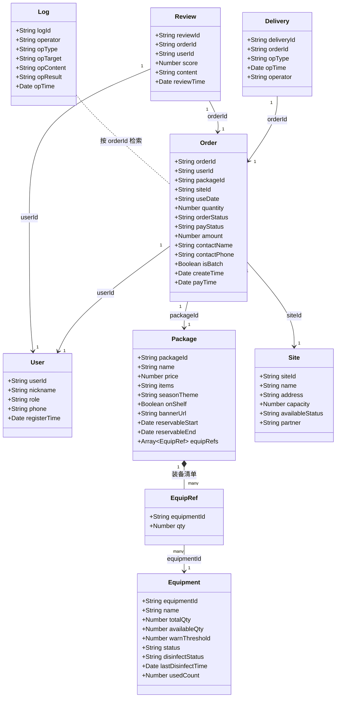
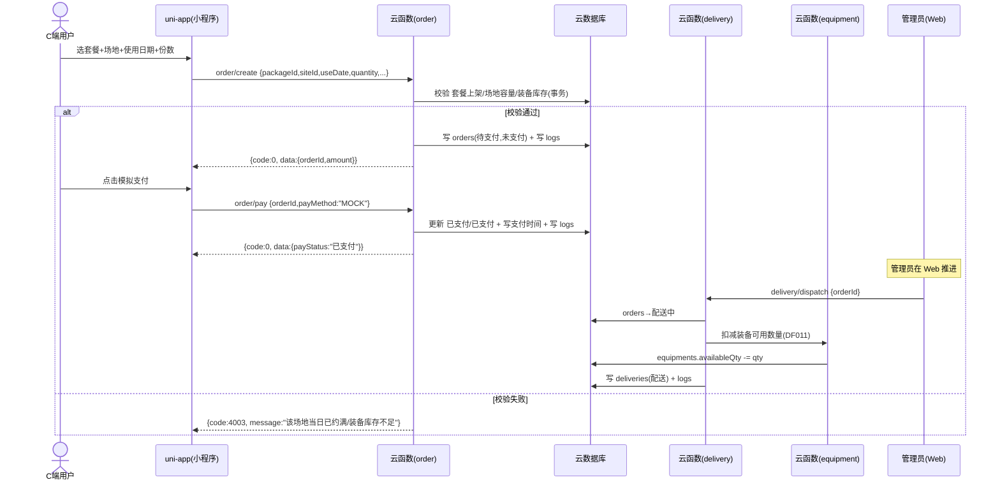
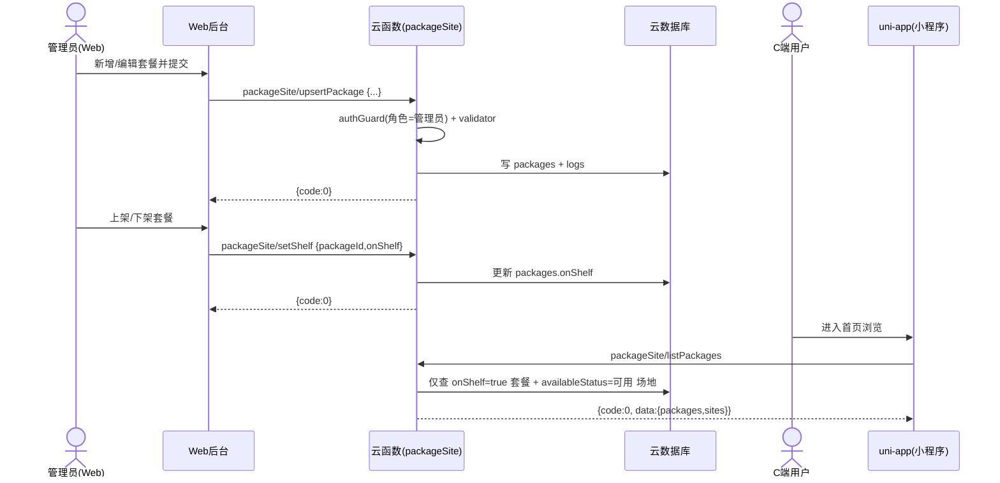
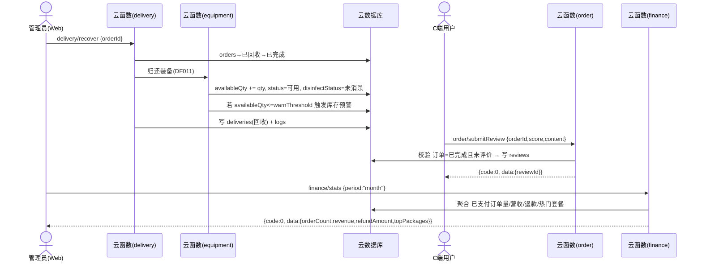
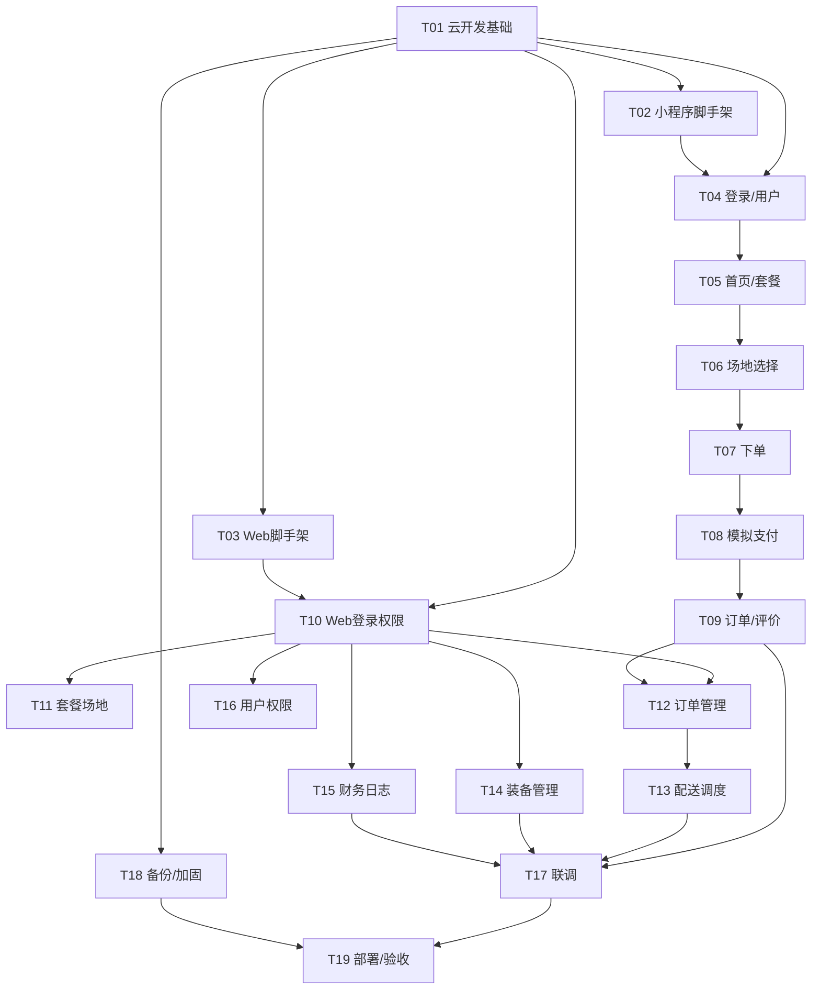

# 城野随行 — 架构设计文档（全端 MVP）

> **版本**：**V1.1** ｜ **日期**：2026-10-19 ｜ **架构师**：高见远（Bob）｜ **修订**：技术栈由「微信云开发 + 微信小程序原生」替换为「DCloud uniCloud + uni-app」
> **依据**：《城野随行 需求规格说明书 V2.2》（CYSX-2026-10-17）｜ 范围：C端小程序 + B端企业 + 系统管理后台（全端 MVP）
> **说明**：SRS 已具备（等同 PRD），跳过 PRD 直接做架构 + 任务分解。DFD 源图文件（指定路径 `D:\Downloads\城野随行_DFD补画\`）在本机未找到，本次设计以 SRS 正文中的 **DFD 文字描述 + 数据字典（DE001–DE026 / DF001–DF011 / D1–D8 / E1–E3）+ 加工逻辑（P1–P6、P3.1–P3.5）** 为准（见第 8 节待明确事项）。

---

## 0. 关键选型结论（先给结论）

| # | 决策项 | 结论 | 一句话理由 |
|---|--------|------|-----------|
| 1 | 技术栈 | **uni-app（编译为微信小程序 / H5 / App，Vue 语法，不使用原生 WXML/WXSS）** | 用户最终决策：跨端复用（一套代码出微信小程序+H5+App），仍满足 SRS 2.3 运行环境；以 Vue 单文件组件开发。 |
| 2 | B端 + 管理员形态 | **Web 管理后台（Vue3 + Element Plus）** | SRS 2.1「以小程序为核心载体，**配套轻量 Web 管理后台**」、2.3「管理端前端采用 Vue3 + Element Plus」已明确；且 B端需「导出对账单」、管理员需批量维护，PC Web 体验最佳。 |
| 3 | 后端方案 | **DCloud uniCloud（云函数 + 云数据库 + 云存储）** | 用户最终决策：与 uni-app 同生态、云端一体（HBuilderX/CLI 直连），**零自建服务器、部署便捷、答辩可行性最高**，天然满足 HTTPS、安全规则、定时触发器备份等非功能需求。 |
| 4 | 支付 | **模拟支付**（参数结构对齐微信支付，预留切换正式环境） | SRS 1.3.1「暂不支持真实资金交易」；接口入参/出参镜像微信支付，后续仅需替换 `pay` 云函数内部实现。 |
| 5 | 配送/回收执行方 | **管理员在 Web 后台点击推进**，无配送员 APP | SRS 1.3.1「暂不支持配送人员移动端 APP（由管理员后台统一模拟操作）」。 |

> **结论对主理人原提问的直接回应**：你提出的「B端/admin 用独立小程序还是 Web 后台」——**SRS 已给出答案，选 Web 后台**（课程设计最常见、也最契合对账单导出/批量维护场景）。技术栈——**C端由微信小程序原生改为 uni-app，后端由微信云开发改为 DCloud uniCloud**（V1.1 增量修订，用户最终决策）。模块映射(P1–P6)、数据模型(D1–D8)、接口契约、任务分解保持不变。

---

## 1. 实现方案 + 框架选型

### 1.1 总体架构（三层 + uniCloud 底座）

```
┌──────────────────────────────┐         ┌──────────────────────┐
│  C端 uni-app(编译为微信小程序/H5/App)│      │  B端 + 管理员 Web后台    │
│  Vue 单文件组件              │         │  Vue3 + Element Plus   │
│  (消费者/企业下单入口)         │         │  (企业管理/运营后台)      │
└──────────┬───────────────────┘         └──────────┬───────────┘
           │  uniCloud.callFunction            │  云函数 URL化 HTTP / uniCloud JS SDK
           │  (同环境免鉴权)                    │  (自定义登录 JWT)
           ▼                                 ▼
┌─────────────────────────────────────────────────────────┐
│                    DCloud uniCloud (云函数+云数据库+云存储)  │
│  ┌────────────┐  ┌──────────────┐  ┌─────────────────┐  │
│  │  云函数      │  │  云数据库      │  │  云存储           │  │
│  │ (Node16)    │  │ (NoSQL文档)   │  │ (轮播图/场地图)    │  │
│  │ user/order/ │  │ users/packages│  │                  │  │
│  │ delivery... │  │ /orders/...   │  │                  │  │
│  └────────────┘  └──────────────┘  └─────────────────┘  │
│  common: authGuard / logger / validator / response       │
└─────────────────────────────────────────────────────────┘
```

- **C端↔云**：直接用 uni-app 内置 `uniCloud.callFunction({name, data:{action, ...}})`，同 uniCloud 环境内调用**免登录票据**，客户端身份（uid/openid）由云函数 `context`（或 uni-id 体系）获取（最安全）。
- **Web↔云**：通过 **uniCloud 云函数 URL化 HTTP 端点**（或 uniCloud 前端网页托管），Web 端用 **自定义登录**：先 `webLogin` 云函数校验后签发 **JWT**，后续 POST 请求携带 `Authorization`；云函数入口做**二次身份校验**。

### 1.2 C端：uni-app — 目录约定

工程根目录 `uniapp/`，采用 **pages / components / services / utils / store / models** 分层（uni-app 单文件组件 `.vue`）：

- `pages/` 一个页面一个文件夹（`pages/order/order.vue`，uni-app 单文件组件，含 `<template>/<script>/<style>`）。
- `components/` 纯展示/复用组件（`.vue`），不承载业务逻辑。
- `services/` 按业务域封装云函数调用（**统一 `call(name, action, data)`，真实模式走 `uniCloud.callFunction`**，非 `wx.cloud.callFunction`）。
- `utils/` 横切能力（request 封装、auth 登录态、格式化）。
- `store/` 轻量全局状态（基于 `App.vue` 的 `globalData` + 订阅式 store，不引第三方状态库，保持轻量）。
- `models/` 数据模型/字段常量（与云数据库集合字段一一对应，便于前后端对齐）。

### 1.3 B端 + 管理员：Web 管理后台（Vue3）

- 单仓库 `web/`：`Vite + Vue3 + Element Plus + Pinia + Vue-Router + Axios + ECharts`。
- B端企业客户与管理员**共用同一套 Web 后台**，登录后按 `role` 动态渲染菜单与权限（管理员全功能；企业客户仅「批量下单 / 我的订单 / 对账单导出」）。
- 理由：避免维护三套工程；SRS 将 B端特性（导出对账单）归入「管理端」描述，共用 Web 最自然。
- **请求层调整（V1.1）**：Web 后台不再调用云开发 HTTP 访问服务，改为调用 **uniCloud 云函数 URL化 HTTP 端点**（POST 对应云函数的 `{action, ...}` 入参）；Vue3 + Element Plus + Pinia + Axios 等技术栈不变。

### 1.4 后端：DCloud uniCloud — 模块划分

云函数按业务域**单一职责**划分（对应 SRS 3.2.6 可维护性需求）：

| 云函数 | 对应加工 | 职责 |
|--------|----------|------|
| `login` | P1 | 微信 code→openid，自动注册/读取角色 |
| `user` | P1 | 用户资料、角色/权限管理（管理员） |
| `packageSite` | P2 | 套餐与场地 CRUD、上下架、前台查询 |
| `order` | P3 | 订单创建(P3.1)/支付(P3.2)/状态跟踪(P3.3)/评价(P3.4)/查询(P3.5) |
| `delivery` | P4 | 配送/布置/回收状态推进，触发装备出入库(DF011) |
| `equipment` | P5 | 装备库存、维修/报废、消杀登记、预警 |
| `finance` | P6 | 营收/退款统计、热门套餐排行 |
| `webLogin` | — | Web 自定义登录签发 JWT |
| `common/*` | — | response / authGuard / logger / validator / dbHelper |
| `timerBackup` | — | 定时触发器（每日 03:00 备份，3.2.3） |

云函数示例（uniCloud，去掉 `wx-server-sdk`，改用内置 `uniCloud.database()`）：
```js
// uniapp/uniCloud/cloudfunctions/order/index.js
const db = uniCloud.database()
exports.main = async (event, context) => {
  const { action, ...data } = event
  const res = await db.startTransaction()   // 事务防超卖（P3.1）
  // ... 按 action 路由：create / pay / list / submitReview
  return { code: 0, message: 'success', data: {} }
}
```
> action 路由结构（create/pay/list/submitReview 等）与 V1.0 保持一致，仅运行环境与 SDK 由 `wx-server-sdk` 切换为 uniCloud 内置。

### 1.5 模块映射（DFD → 代码）

```
P1 用户管理      → login + user 云函数 + 小程序 login/mine 页 + Web user-manage
P2 套餐场地管理   → packageSite 云函数 + 小程序 index/packageDetail/siteSelect + Web package/site-manage
P3 订单管理      → order 云函数 + 小程序 orderCreate/orderList/orderDetail/review + Web order-manage
P4 配送调度      → delivery 云函数 + Web delivery-manage
P5 装备管理      → equipment 云函数 + Web equipment-manage
P6 财务管理      → finance 云函数 + Web finance + log
D1–D8           → 云数据库 8 个集合（见 §3.2）
```

---

## 2. 文件列表及相对路径

> 根目录：`D:/path/to/chengye-suirong\`
> 三个子工程：`uniapp/`（C端 + uniCloud 云函数，含 `uniapp/uniCloud/cloudfunctions/`）、`web/`（B端+管理后台）。旧 `miniprogram/`、`cloudfunctions/` 已归档至 `archive/` 供参考。

### 2.1 C端工程树 `uniapp/`

| 文件 | 职责 |
|------|------|
| `main.js` / `App.vue` | uni-app 入口，初始化 uniCloud、globalData（openid/role/userInfo）、轻量 store |
| `pages.json` | 全局页面路由注册、窗口样式、tabBar（替代小程序 app.json） |
| `uni.scss` / `App.vue <style>` | 全局样式 + **主题 CSS 变量**（`--primary` 等，见 §7） |
| `manifest.json` | uni-app 项目配置（微信小程序 appid、H5/App 打包参数） |
| `pages/index/index.vue` | 首页：轮播图 + 套餐列表 |
| `pages/packageDetail/packageDetail.vue` | 套餐详情（含装备清单预览） |
| `pages/siteSelect/siteSelect.vue` | 场地选择（容量/可用状态/日期） |
| `pages/orderCreate/orderCreate.vue` | 下单（C端单笔 / B端批量复用，isBatch 区分） |
| `pages/orderPay/orderPay.vue` | 模拟支付确认 |
| `pages/orderList/orderList.vue` | 我的订单列表 |
| `pages/orderDetail/orderDetail.vue` | 订单详情 + 状态时间线 |
| `pages/review/review.vue` | 提交评价（P3.4） |
| `pages/mine/mine.vue` | 个人中心（角色展示、登录态） |
| `pages/login/login.vue` | 微信授权登录入口 |
| `components/package-card/package-card.vue` | 套餐卡片 |
| `components/site-card/site-card.vue` | 场地卡片 |
| `components/order-timeline/order-timeline.vue` | 订单状态时间线（7 态） |
| `components/rate-star/rate-star.vue` | 评分星（1–5） |
| `components/nav-bar/nav-bar.vue` | 自定义导航栏 |
| `utils/request.js` | 云函数调用封装 `call(name, action, data)`（底层走 `uniCloud.callFunction`）+ 统一错误处理 |
| `utils/auth.js` | 登录态管理（openid/role 存取、静默登录） |
| `utils/util.js` | 日期格式化、金额格式化、状态文案映射 |
| `services/user.js` | 用户域接口封装 |
| `services/package.js` | 套餐/场地查询封装 |
| `services/order.js` | 订单域（创建/支付/查询/评价）封装 |
| `services/review.js` | 评价封装 |
| `store/user.js` | 用户全局状态（订阅式） |
| `models/constants.js` | 角色/订单状态/支付状态等枚举常量（前后端共享语义） |
| `models/schemas.js` | 集合字段常量（与 D1–D8 对齐，便于校验） |

### 2.2 云函数工程树 `uniapp/uniCloud/cloudfunctions/`

| 文件 | 职责 |
|------|------|
| `uniapp/uniCloud/cloudfunctions/common/response.js` | 统一返回 `{code,message,data}` |
| `uniapp/uniCloud/cloudfunctions/common/authGuard.js` | 角色校验中间件（C端/B端/管理员） |
| `uniapp/uniCloud/cloudfunctions/common/logger.js` | 写 D8 操作日志（敏感操作必写） |
| `uniapp/uniCloud/cloudfunctions/common/validator.js` | 入参类型/范围校验、防 NoSQL 注入（`$`/操作符拦截） |
| `uniapp/uniCloud/cloudfunctions/common/dbHelper.js` | 集合引用、事务（订单创建需事务防超卖，使用 `db.startTransaction()`） |
| `uniapp/uniCloud/cloudfunctions/login/index.js` | 微信登录→openid→注册/读取角色 |
| `uniapp/uniCloud/cloudfunctions/user/index.js` | P1 用户管理 |
| `uniapp/uniCloud/cloudfunctions/packageSite/index.js` | P2 套餐与场地管理 |
| `uniapp/uniCloud/cloudfunctions/order/index.js` | P3 订单管理（action 路由） |
| `uniapp/uniCloud/cloudfunctions/delivery/index.js` | P4 配送调度 |
| `uniapp/uniCloud/cloudfunctions/equipment/index.js` | P5 装备管理 |
| `uniapp/uniCloud/cloudfunctions/finance/index.js` | P6 财务管理 |
| `uniapp/uniCloud/cloudfunctions/webLogin/index.js` | Web 自定义登录（签发 JWT） |
| `uniapp/uniCloud/cloudfunctions/initDB/index.js` | 初始化 8 个集合 + 种子数据（套餐/场地/装备） |
| `uniapp/uniCloud/cloudfunctions/timerBackup/index.js` | 定时备份（每日 03:00） |
| `uniapp/uniCloud/cloudfunctions/*/package.json` | 各函数依赖与超时配置（uniCloud 内置依赖，无需 wx-server-sdk；timeout 5s，见 §3.3） |

### 2.3 Web 管理后台工程树 `web/`

| 文件 | 职责 |
|------|------|
| `web/package.json` `vite.config.js` `index.html` | 工程与构建配置 |
| `web/src/main.js` | 入口（挂载 Pinia/Router/ElementPlus） |
| `web/src/App.vue` | 根组件 + 布局插槽 |
| `web/src/router/index.js` | 路由 + **角色守卫（管理员/企业）** |
| `web/src/store/user.js` (Pinia) | 当前管理员/企业用户态、JWT |
| `web/src/utils/request.js` | Axios 封装（自动带 JWT、统一 `code/message/data` 处理） |
| `web/src/utils/auth.js` | JWT 存取、过期校验 |
| `web/src/layouts/BasicLayout.vue` | 侧边菜单 + 顶栏布局 |
| `web/src/views/login/Login.vue` | 管理员/企业登录 |
| `web/src/views/dashboard/Dashboard.vue` | 数据概览（ECharts 营收图） |
| `web/src/views/package/PackageManage.vue` | 套餐 CRUD + 上下架 + 轮播图 |
| `web/src/views/site/SiteManage.vue` | 场地白名单维护 |
| `web/src/views/order/OrderManage.vue` | 订单查询/详情/退款/取消 |
| `web/src/views/delivery/DeliveryManage.vue` | 配送/布置/回收推进（P4） |
| `web/src/views/equipment/EquipmentManage.vue` | 装备库存/维修/报废/消杀（P5） |
| `web/src/views/finance/Finance.vue` | 营收统计/对账单导出（P6） |
| `web/src/views/log/LogManage.vue` | 操作日志检索（按 orderId/userId） |
| `web/src/views/user/UserManage.vue` | 用户与角色权限管理 |
| `web/src/views/enterprise/BatchOrder.vue` | B端企业批量下单 |
| `web/src/views/enterprise/MyOrders.vue` | B端企业订单/对账单 |
| `web/src/api/*.js` | 各域接口封装（对应云函数 action） |
| `web/src/styles/theme.scss` | Element Plus 主题变量 |

---

## 3. 数据结构和接口

### 3.1 数据模型（实体关系 / 类图）

> 完整 Mermaid 见同目录 `class-diagram.mermaid`。



### 3.2 集合字段定义（D1–D8 映射）

| 集合 | SRS | 关键字段 | 备注 |
|------|-----|----------|------|
| `users` | D1 | userId(openid), nickname, role(C端/B端/管理员), phone, registerTime | userId = 微信 openid（DE001） |
| `packages` | D2 | packageId, name, price, items, seasonTheme, onShelf, bannerUrl, reservableStart, reservableEnd, equipRefs[] | 增 reservableStart/End 支撑「可预约周期」校验（P3.1） |
| `sites` | D3 | siteId, name, address, capacity, availableStatus, partner | availableStatus=可用/停用 |
| `orders` | D4 | orderId, userId, packageId, siteId, useDate, quantity, orderStatus, payStatus, amount, contactName, contactPhone, isBatch, createTime, payTime | orderStatus 7 态 + 已取消 |
| `equipments` | D5 | equipmentId, name, totalQty, availableQty, warnThreshold, status, disinfectStatus, lastDisinfectTime, usedCount | usedCount 支撑「循环复用≥30次」指标 |
| `deliveries` | D6 | deliveryId, orderId, opType(配送/布置/回收), opTime, operator | |
| `reviews` | D7 | reviewId, orderId, userId, score(1-5), content, reviewTime | |
| `logs` | D8 | logId, operator, opType, opTarget, opContent, opResult, opTime | 保存≥1年，可检索 |

**订单状态机（orderStatus）**：
`待支付 → 已支付 → 配送中 → 布置中 → 使用中 → 已回收 → 已完成`，任意态可转 `已取消`（P3.3 校验合法流转，拒绝跳变/回退）。

### 3.3 接口契约

**统一返回结构**（SRS 3.3）：
```json
{ "code": 0, "message": "success", "data": {} }
```
- `code=0` 成功；`4xx` 业务异常；`5xx` 系统异常。
- 云函数超时 5s、失败重试≤2 次；入参做类型/范围校验，拦截 NoSQL 操作符注入。
- **调用方式（V1.1）**：C端经 `uniCloud.callFunction({name, data:{action, ...}})`（非 `wx.cloud.callFunction`）；Web 端经 **uniCloud 云函数 URL化 HTTP 端点 POST** `{action, ...}`；两者入参/出参结构完全一致，错误码表见下。

**错误码约定**：

| code | 含义 |
|------|------|
| 0 | 成功 |
| 4001 | 参数错误/非法 |
| 4002 | 订单状态非法（流转校验失败） |
| 4003 | 套餐已下架 / 场地约满 / 装备库存不足 |
| 4004 | 无权限（非管理员/越权） |
| 4009 | 重复操作（如重复评价、重复支付） |
| 500x | 系统异常（数据库/云函数错误） |

**核心云函数契约（节选）**：

| 云函数 | action | 请求 (data) | 响应 (data) | 对应加工 |
|--------|--------|-------------|-------------|----------|
| `login` | — | `{code}` | `{openid, role, nickname, isNew}` | P1 |
| `order` | `create` | `{packageId, siteId, useDate, quantity, contactName, contactPhone, isBatch}` | `{orderId, orderStatus, amount}` | P3.1 |
| `order` | `pay` | `{orderId, payMethod:"MOCK"}` | `{payStatus, payTime, amount}` | P3.2 |
| `order` | `list` | `{filter:{orderStatus?,dateStart?,dateEnd?,orderId?}, page}` | `{list:[...], total}` | P3.5 |
| `order` | `submitReview` | `{orderId, score(1-5), content}` | `{reviewId}` | P3.4 |
| `delivery` | `dispatch/setup/recover` | `{orderId, operator}` | `{orderStatus}` | P4 |
| `packageSite` | `listPackages` | `{}`(前台) / `{admin:true}` | `{packages:[...], sites:[...]}` | P2 |
| `packageSite` | `upsertPackage` | `{name, price, items, seasonTheme, ...}` | `{packageId}` | P2 |
| `equipment` | `disinfect` | `{equipmentId}` | `{disinfectStatus, lastDisinfectTime}` | P5 |
| `finance` | `stats` | `{period:"day|week|month|custom", start?, end?}` | `{orderCount, revenue, refundAmount, topPackages:[...]}` | P6 |

**`order/create` 请求 JSON Schema（示例）**：
```json
{
  "type": "object",
  "required": ["packageId","siteId","useDate","quantity"],
  "properties": {
    "packageId":  { "type": "string", "minLength": 1, "maxLength": 20 },
    "siteId":     { "type": "string", "minLength": 1, "maxLength": 20 },
    "useDate":    { "type": "string", "pattern": "^\\d{4}-\\d{2}-\\d{2}$" },
    "quantity":   { "type": "integer", "minimum": 1 },
    "isBatch":    { "type": "boolean", "default": false },
    "contactName":  { "type": "string", "maxLength": 30 },
    "contactPhone": { "type": "string", "pattern": "^1\\d{10}$" }
  }
}
```

**`order/create` 内部校验链（P3.1）**：套餐上架 → 使用日期∈可预约周期 → 场地当日剩余容量≥quantity（读 sites）→ 装备可用数量≥quantity（读 equipments）→ 全部通过则**事务**写入 orders(待支付/未支付) 并写日志；任一失败返回 4003 + 明确原因。

---

## 4. 程序调用流程（时序图）

> 完整 Mermaid 见同目录 `sequence-diagram.mermaid`（含 3 个核心用例）。

**用例 A：C端下单 → 模拟支付 → 配送调度**



**用例 B：管理员套餐与场地管理（P2 上架审核）**



**用例 C：回收消杀 + 用户评价 + 财务统计闭环**



---

## 5. 任务列表（有序、含依赖）

> 共 **19** 个开发任务，分 **5 大阶段**（基础设施→C端→Web后台→联调→交付）。首任务为基础设施。依赖关系按「先公共层、再各端页面、最后联调」排列。详细任务供主理人据此创建团队任务并分派工程师。

### 5.1 阶段总览（5 大阶段）

| 阶段 | 任务 | 产出 |
|------|------|------|
| 阶段0 基础设施 | T01–T03 | 云环境+公共模块、小程序脚手架、Web脚手架 |
| 阶段1 C端小程序 | T04–T09 | 登录/浏览/选场地/下单/支付/订单评价 |
| 阶段2 Web后台 | T10–T16 | 登录权限/套餐场地/订单/配送/装备/财务日志/用户 |
| 阶段3 联调 | T17 | 端到端流程与状态机校验 |
| 阶段4 交付 | T18–T19 | 备份加固、部署与验收材料 |

### 5.2 详细任务

| ID | 名称 | 所属端/模块 | 依赖 | 预估涉及文件 | 优先级 |
|----|------|-------------|------|--------------|--------|
| T01 | 云开发环境 + 公共模块 + 数据库集合 | 后端 | 无 | `cloudfunctions/common/*`, `initDB`, `login`, `cloudbaserc.json` | P0 |
| T02 | 小程序工程脚手架 + 公共层 | C端 | T01 | `miniprogram/app.*`, `utils/*`, `services/`基础, `store/*`, `models/*` | P0 |
| T03 | Web后台脚手架 + 公共层 | Web | T01 | `web/` 配置, `router`, `store`, `utils/request`, `layouts` | P0 |
| T04 | 微信登录 + 用户体系(P1) | C端/后端 | T02,T01 | `login`,`user` 云函数；`pages/login`,`pages/mine` | P0 |
| T05 | 首页 + 套餐浏览(P2查询) | C端 | T04 | `packageSite`(list)；`pages/index`,`packageDetail`,`components/package-card` | P1 |
| T06 | 场地选择 | C端 | T05 | `pages/siteSelect`,`components/site-card` | P1 |
| T07 | 下单(P3.1) + B端批量下单 | C端/后端 | T06,T04 | `order`(create,事务)；`pages/orderCreate` | P0 |
| T08 | 模拟支付(P3.2) | C端/后端 | T07 | `order`(pay)；`pages/orderPay` | P0 |
| T09 | 订单列表/详情/评价(P3.3/3.4/3.5) | C端 | T08 | `order`(list/track/submitReview)；`pages/orderList`,`orderDetail`,`review`,`components/order-timeline`,`rate-star` | P1 |
| T10 | 管理员/企业登录 + 权限路由 | Web/后端 | T03 | `webLogin` 云函数；`views/login`, 路由守卫 | P0 |
| T11 | 套餐与场地管理(P2 CRUD) | Web/后端 | T10 | `packageSite`(admin)；`views/package`,`views/site` | P1 |
| T12 | 订单管理(P3 查询/退款/取消) | Web/后端 | T10,T09 | `order`(admin query/refund/cancel)；`views/order` | P1 |
| T13 | 配送调度(P4) | Web/后端 | T12 | `delivery`；`views/delivery` | P1 |
| T14 | 装备管理(P5) | Web/后端 | T10 | `equipment`；`views/equipment` | P1 |
| T15 | 财务管理 + 操作日志(P6) | Web/后端 | T10 | `finance`；`views/finance`,`views/log` | P1 |
| T16 | 用户与权限管理 | Web/后端 | T10,T04 | `user`(admin)；`views/user` | P2 |
| T17 | 端到端联调 + 状态机校验 | 全端 | T09,T13,T14,T15 | 跨端联调、状态流转脚本校验 | P0 |
| T18 | 备份定时任务 + 安全/性能加固 | 后端 | T01 | `timerBackup`；authGuard/validator 强化；压测脚本 | P1 |
| T19 | 部署 + 验收材料 | 全端 | T17,T18 | 云函数部署、Web 托管、验收报告/测试用例 | P1 |

**任务依赖图**（Mermaid）：



---

## 6. 依赖包列表

**C端 uni-app（构建用 HBuilderX / uni-app CLI）**：

| 包 | 版本 | 用途 |
|----|------|------|
| `uni-app` 框架 | — | 跨端框架，编译为微信小程序 / H5 / App，Vue 单文件组件 |
| `uni-cloud` | 内置 | uniApp 云端一体 SDK（`uniCloud.callFunction` / `uniCloud.database`），**无需 wx-server-sdk** |
| `uni-ui` / `uView` | ^1.x | 可选 UI 组件库（卡片/步骤条/评分/弹窗），替代原生 `vant-weapp` |
| `dayjs` | ^1.11 | 日期格式化（useDate、支付时间、日志时间） |
| `lodash` | ^4.17 | 可选工具函数（深拷贝/防抖） |

> 注：状态管理用自研轻量 store（不引 Redux/MobX 类库），降低构建复杂度；UI 库可按需选 uni-ui 或 uView。

**云函数（uniCloud，Node.js 16）**：

| 包 | 版本 | 用途 |
|----|------|------|
| `uni-cloud`（内置） | — | 云函数运行环境自带，`uniCloud.database()` / 事务 / 云存储，无需 `wx-server-sdk` |
| `jsonwebtoken` | ^9.0 | Web 自定义登录签发/校验 JWT |
| `node-fetch` | ^2.6 | 可选调用外部（本场景基本不用） |

**Web 管理后台**：

| 包 | 版本 | 用途 |
|----|------|------|
| `vue` | ^3.4 | 前端框架 |
| `vue-router` | ^4.3 | 路由 + 角色守卫 |
| `pinia` | ^2.1 | 状态管理 |
| `element-plus` | ^2.7 | UI 组件库 |
| `axios` | ^1.7 | HTTP 请求封装 |
| `echarts` | ^5.5 | 财务营收图表 |
| `dayjs` | ^1.11 | 日期处理 |
| `vite` | ^5.2 | 构建工具 |
| `sass` | ^1.77 | 主题样式 |

---

## 7. 共享知识（跨文件约定）

1. **统一返回**：所有云函数返回 `{code, message, data}`，`code=0` 成功、`4xx` 业务、`5xx` 系统（详见 §3.3）。
2. **角色常量**（前后端一致）：`ROLE_C='C端'`、`ROLE_B='B端'`、`ROLE_ADMIN='管理员'`（存 `models/constants.js` 与云函数共用语义）。
3. **订单状态机**：7 态 + 已取消，流转校验集中在 `order`/`delivery` 云函数，前端仅展示不裁决。
4. **登录态管理**：
   - C端：`uniCloud.callFunction` 同环境调用，uid/openid 由云函数 `context`（或 uni-id）获取；本地仅缓存 `role/userInfo`，不缓存 openid 明文。
   - Web：`webLogin` 签发 JWT 存 `localStorage`，`request.js` 自动带 `Authorization`；云函数 `authGuard` 二次校验。
5. **请求封装约定**：C端 `uniapp/utils/request.js` 暴露 `call(name, action, data)`（底层 `uniCloud.callFunction`）；Web `web/src/utils/request.js` 暴露 `request(action, data)`（baseURL 指向 **uniCloud 云函数 URL化 HTTP 端点**），两者都对 `code≠0` 统一 toast/报错。
6. **命名规范**：
   - 集合名：复数小写下划线（`users/packages/sites/orders/equipments/deliveries/reviews/logs`）。
   - 云函数 action：小驼峰（`create`/`pay`/`listPackages`/`disinfect`）。
   - uni-app 页面/组件：`.vue` 单文件组件（中划线目录 + 同名单文件）；Web 组件：大驼峰 `.vue`。
7. **安全约定**：云函数入口必走 `validator`（拦截 `$` 开头的 NoSQL 操作符、校验字段类型/范围）；敏感操作（支付/退款/取消/角色变更/配送推进）必写 `logs`（D8）；集合级权限设为「仅创建者可读写 + 云函数管理端绕过」。
8. **主题 token**：
   - uni-app `uni.scss` / `App.vue <style>` 定义 CSS 变量：`--primary:#2E7D32`（营地绿）、`--bg:#F5F7F4` 等。
   - Web `theme.scss` 配置 Element Plus 主色变量，两端主色一致。
9. **日志约定**：`logs` 字段固定 `operator/opType/opTarget/opContent/opResult/opTime`；检索按 `orderId`/`operator` 建索引。
10. **工程目录归档（V1.1）**：旧 `miniprogram/` 与 `cloudfunctions/` 已归档至 `archive/` 供参考，**新代码统一以 `uniapp/` 为准**（C端页面 + uniCloud 云函数同仓）。

---

## 8. 待明确事项（需主理人/用户拍板）

1. **DFD 源图缺失**：指定路径 `D:\Downloads\城野随行_DFD补画\` 在本机不存在（已检索 Desktop/Documents/Downloads/软件工程/用户目录均无 `.drawio`/相关 png）。本次设计完全依据 SRS V2.2 正文（DFD 文字描述 + 数据字典 + 加工逻辑）。**若后续提供 7 张 DFD 图，需复核模块边界与本设计一致性。**
2. **支付真实性**：SRS 明确模拟支付，但需确认答辩/演示是否允许纯模拟，还是需接微信支付沙箱。
3. **Web 登录形态**：自定义登录（JWT，本设计默认）vs uniCloud 云函数 URL化 HTTP 端点令牌——需确认部署形态（uniCloud 前端网页托管 vs 独立部署 Web）。
4. **B端企业认证**：SRS 未明确定义企业注册/资质审核流程；本设计默认「同一 openid 注册后由管理员置为 B端角色、共用 Web 后台」，请确认是否足够。
5. **多城市/多租户**：SRS 暂不支持跨区域调度，本设计按单城市实现；如需预留请告知。
6. **备份定时器**：`timerBackup`（每日 03:00）是否需实际配置 uniCloud 定时触发器，或仅留函数待演示。
7. **语言**：用户确认小程序用 JS（非 TS），本设计全程 JS；如改 TS 需同步调整脚手架与类型定义。

---

## 一句话总结

**IS_PASS：YES**（架构自洽、可落地——SRS 已明确 C端 + Web 后台 + 云后端三层选型，模块与 DFD 的 P1–P6 及 D1–D8 完全对齐，任务分解有序可达 MVP；唯一外部阻塞为 DFD 源图缺失，已用 SRS 正文替代并列入待明确事项）。

> **V1.1 增量修订说明**：技术栈由「微信云开发 + 微信小程序原生」替换为「DCloud uniCloud + uni-app（编译为微信小程序/H5/App）」；Web 后台请求层改为调用 uniCloud 云函数 URL化 HTTP 端点。模块映射(P1–P6)、数据模型(D1–D8)、接口契约(`{code,message,data}`)、任务分解(19 任务) **保持不变**。
