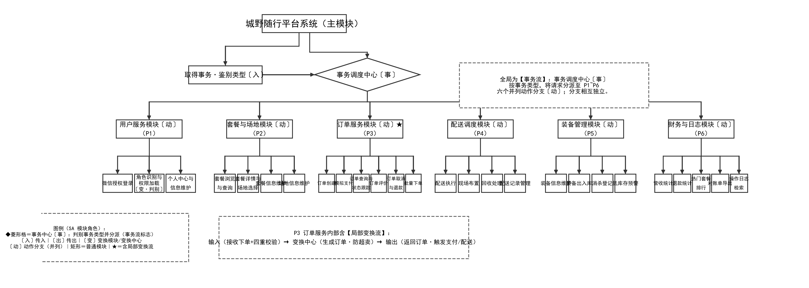
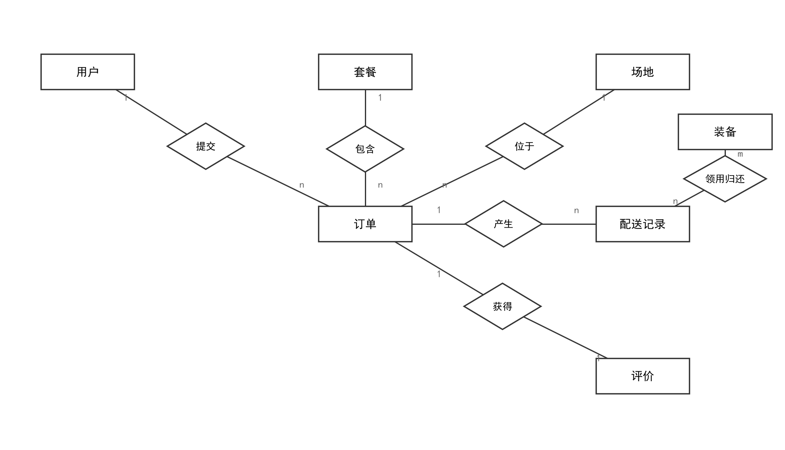
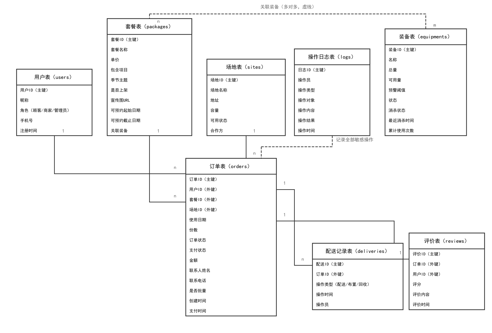
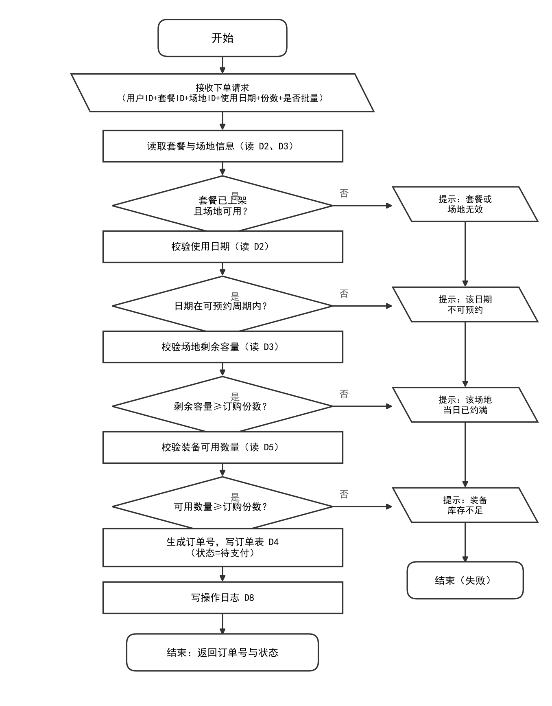

城野随行——季节限定城市微露营

一站式配送托管平台

系统设计说明书

报告编号：【CYSX-SDD-2026-10-21】

编制单位：【城野随行项目组】

编制日期：【2026 年 10 月 21 日】

版本号：【V2.1】

目  录

1. 系统概述	1

- 1.1 项目背景 1
- 1.2 系统目标 1
- 1.3 设计原则 2
2. 系统概要设计	3

- 2.1 设计目标与范围 3
- 2.2 系统软件结构图（业务逻辑） 3
- 2.3 端、云函数与页面映射 5
3. 系统详细设计	6

- 3.1 数据库设计 6
- 3.2 接口设计 9
- 3.3 模块算法设计（以“订单创建”模块为例） 12
4. 系统实施计划	14

- 4.1 实施阶段划分 14
- 4.2 各阶段任务与时间安排 14
- 4.3 资源需求 15
- 4.4 风险与应对措施 16
5. 设计约束与说明	18

- 5.1 性能约束 18
- 5.2 安全约束 18
- 5.3 可维护性约束 19
参与编写本方案设计的人员

| 角色 | 姓名 | 负责章节 |
| --- | --- | --- |
| 组  长： | @lian-hash | 引言、系统概要设计、系统详细设计 |
| 成员： | @teammate-c | 系统详细设计（数据库设计、接口设计）、系统实施计划 |
| 成员： | @teammate-b | 模块算法设计、设计约束与说明、系统实施计划 |

# 1. 系统概述

## 1.1 项目背景

随着城市年轻人对户外休闲需求的持续增长，露营已成为热门的社交与休闲方式。然而传统露营存在装备购置成本高、携带运输麻烦、搭建收纳耗时、场地选择受限等突出痛点。为解决上述问题，本项目开发“城野随行——季节限定城市微露营一站式配送托管平台”，通过“微信小程序下单 + 全城定点配送 + 现场布置 + 用完回收”的闭环服务模式，降低露营门槛，让用户无需购买装备即可享受露营体验。

本系统属于轻量级 O2O 租赁服务平台：上游依托微信开放平台提供登录与支付（模拟）能力，依托 DCloud uniCloud（阿里云空间）提供云函数、云数据库与云存储服务；下游与城市合规场地合作方建立场地白名单机制，保障经营合规。本设计说明书以《城野随行需求规格说明书（V2.2）》及 WorkBuddy 资料库《城野随行-需求文档》为输入基准，完成系统的概要设计与详细设计，作为开发实现、测试验证与项目验收的依据。

## 1.2 系统目标

系统的总体目标是：以微信小程序为核心载体、轻量 Web 管理后台为运营支撑，实现露营套餐浏览、在线下单、模拟支付、配送调度、装备管理与回收消杀、评价反馈与财务统计的全流程管理。系统采用模拟运营模式，不涉及真实资金交易。各项具体目标如表 1-1 所示。

表 1-1 系统目标描述

| 目标类型 | 具体描述 |
| --- | --- |
| 功能目标 | 实现用户管理、套餐与场地管理、订单管理、配送调度、装备管理、财务与日志六大核心功能，覆盖 C 端普通用户、B 端企业客户、系统管理员三类角色，从浏览下单到配送回收再到评价反馈的完整业务闭环 |
| 性能目标 | 套餐浏览首屏加载≤2 秒，订单提交与订单查询响应≤1 秒；并发 50 用户平均响应≤2 秒，峰值并发 100 用户平均响应≤3 秒；试运营期支持日均订单处理 500 笔；全年系统可用性≥99% |
| 业务目标 | 用户从浏览到下单操作步骤≤3 步；单套装备循环复用次数≥30 次；节假日订单按时交付率≥95%；订单全流程状态可追溯率 100% |
| 安全目标 | 全链路 HTTPS 加密传输；按角色最小权限访问（RBAC）；支付、退款、订单取消、权限变更等敏感操作 100% 写入操作日志且不可篡改 |

## 1.3 设计原则

（1）模块化设计：按“高内聚、低耦合”拆分为六大业务模块，云函数按业务域独立部署（login、user、packageSite、order、delivery、equipment、finance），模块间通过云数据库集合与统一返回结构 {code, message, data} 通信，降低依赖风险；

（2）可扩展性：云函数无状态、可水平扩容；架构预留扩展点，后续可平滑新增真实支付、配送人员 APP、多城市调度等能力而无需推翻整体设计；套餐与装备数据模型预留扩展字段；

（3）易用性：小程序端 UI 遵循《微信小程序设计指南》，新用户无需指导即可完成下单，核心流程（选套餐→选场地→提交订单）操作路径≤3 步，关键操作均给出明确结果提示与失败原因说明；

（4）安全性：遵循微信小程序安全开发规范，云函数对所有入参做类型与范围校验以防范 NoSQL 操作符注入，云数据库按角色配置读写安全规则，敏感操作强制写入操作日志；

（5）可维护性：鉴权（authGuard）、日志（logger）、参数校验（validator）、统一响应（response）、数据库封装（dbHelper）等公共能力沉淀为 common 公共模块复用；集合字段命名统一、注释完整；接口变更同步更新接口文档。

# 2. 系统概要设计

## 2.1 设计目标与范围

覆盖范围：

（1）核心模块：用户层（uni-app 编译的微信小程序 C 端/B 端、Vue3 管理端 Web）、业务层（订单、套餐场地、配送调度、装备、财务与日志、用户六大 uniCloud 云函数业务模块 + common 公共支撑模块 + timerBackup 定时备份）、数据层（uniCloud 云数据库 8 个集合、云存储）、支撑层（微信开放平台登录/模拟支付、uniCloud 运行时与监控告警）。

（2）技术范围：后端为 DCloud uniCloud（云函数 + 云数据库 + 云存储，云数据库为 MongoDB 兼容的文档型数据库）；小程序端为 uni-app（Vue3 语法，编译发布至微信小程序）；管理端为 Vue3 + Element Plus，构建工具 Vite。

非覆盖范围：

（1）暂不支持真实资金交易，采用与微信支付参数结构、签名规则保持一致的模拟支付接口（便于后续无缝切换正式环境）；

（2）暂不支持配送人员移动端 APP，配送、布置、回收环节由系统管理员在管理后台模拟推进；

（3）暂不支持多城市跨区域调度，试运营期仅覆盖单一城市。

## 2.2 系统软件结构图（业务逻辑）

系统采用四层 B/S 架构，自上而下分为表现层、业务层、数据层与支撑层。软件结构按结构化设计（SA）方法由分层数据流图映射而来：全局为事务流——主模块经"取得事务·鉴别类型"识别事务类型后，由"事务调度中心"（图中以菱形格醒目标注，菱形专表"判别·分派"）分派至 P1~P6 六个并列动作分支；订单服务（P3）内部含局部变换流（输入：接收下单+四重校验 → 变换中心：生成订单·防超卖 → 输出：返回订单·触发支付/配送）。软件结构如图 2-1 所示。

（1）表现层：微信小程序（uni-app 编译）面向 C 端普通用户与 B 端企业客户，提供套餐浏览、场地选择、下单支付、订单跟踪、评价提交等功能；Vue3 + Element Plus 管理端面向系统管理员，提供套餐/场地维护、订单与退款处理、配送调度模拟推进、装备与消杀管理、财务统计、用户与权限管理等功能。

（2）业务层：由 9 个云函数构成，与需求规格分层数据流图（DFD）中的六大加工一一对应，另设 common 公共模块与 timerBackup 定时备份函数，各模块主要功能如表 2-1 所示。

（3）数据层：云数据库 8 个集合（users、packages、sites、orders、equipments、deliveries、reviews、logs，对应数据存储 D1~D8）与云存储（套餐轮播图、每日备份 JSON 文件），业务层通过 dbHelper 封装直接读写。

（4）支撑层：微信开放平台（登录接口 jscode2session、模拟支付接口）、DCloud uniCloud运行时与 SDK、uniCloud监控告警，为业务层提供身份、支付、算力与可观测性支撑。

表 2-1 核心模块功能描述

| 业务模块 | 对应云函数 | 对应 DFD 加工 | 主要功能 |
| --- | --- | --- | --- |
| 用户管理 | login / user / webLogin | P1 用户管理 | 小程序微信授权登录换取 openid、新用户注册、角色识别与权限加载；管理端自定义登录；用户信息与角色维护 |
| 套餐与场地管理 | packageSite | P2 套餐与场地管理 | 季节限定套餐的新增/修改/上下架、包含物品与可预约周期维护；合规场地白名单维护、容量与可用状态管理；向用户端输出已上架套餐与可用场地（DF004） |
| 订单管理 | order | P3 订单管理 | 订单创建（P3.1）、模拟支付确认（P3.2）、状态跟踪（P3.3）、评价管理（P3.4）、订单查询（P3.5），覆盖待支付→已支付→配送中→布置中→使用中→已回收→已完成/已取消全状态流转 |
| 配送调度 | delivery | P4 配送调度 | 由管理员模拟推进配送/布置/回收操作，按订单状态合法流转校验后更新订单状态（DF007），触发装备出入库（DF011）并写入配送记录 D6 |
| 装备管理 | equipment | P5 装备管理 | 装备领用/归还出入库、消杀登记、维修/报废处理；可用数量与预警阈值比较，低于阈值向管理员输出库存预警；跟踪复用次数 |
| 财务与日志 | finance | P6 财务与日志 | 按统计周期（日/周/月/自定义）统计订单量、营收金额、热门套餐排行与退款金额，输出经营统计数据（DF010） |
| 公共支撑 | common 公共模块 | — | 鉴权（authGuard）、日志（logger）、参数校验（validator）、统一响应（response）、数据库集合引用与事务封装（dbHelper） |
| 定时备份 | timerBackup | — | 每日凌晨 03:00 定时触发，将用户表、订单表、装备表导出为 JSON 存入云存储，保留 30 天 |

## 2.3 端、云函数与页面映射

依据 WorkBuddy 资料库《城野随行-需求文档》，系统六大业务加工（P1~P6）、uniCloud 云函数、C 端 uni-app 页面与 Web 管理后台页面的对应关系如表 2-2 所示，开发实现与测试覆盖核对均按此映射逐条进行。

| 业务加工（模块） | 云函数 | C 端页面（uni-app） | 后台页面（Web） |
| --- | --- | --- | --- |
| P1 用户管理 | login / user | login, mine | UserManage |
| P2 套餐场地管理 | packageSite | index, packageDetail, siteSelect | PackageManage, SiteManage |
| P3 订单管理 | order | orderCreate, orderPay, orderList, orderDetail, review | OrderManage, BatchOrder, MyOrders |
| P4 配送调度 | delivery | — | DeliveryManage |
| P5 装备管理 | equipment | — | EquipmentManage |
| P6 财务与日志 | finance | — | Finance, LogManage |

表 2-2 端、模块、云函数与页面映射表

# 3. 系统详细设计

## 3.1 数据库设计

### 3.1.1 概念结构设计（E-R 图）

通过对需求规格数据字典（D1~D8 数据存储、DE001~DE026 数据项）的抽象，系统概念模型共包含用户、套餐、场地、订单、配送记录、评价、装备 7 个业务实体；操作日志（D8）为审计数据存储，不参与业务联系，在逻辑结构设计图中以虚线弱关联表达，不计入概念实体。E-R 图如图 3-1 所示。

主要联系说明：用户与订单为 1:N 联系（一名用户可通过 DF001/DF002 创建多笔订单）；套餐与订单、场地与订单均为 1:N 联系；订单与配送记录为 1:N 联系（一笔订单在履约过程中产生配送、布置、回收多条操作记录）；订单与评价为 1:1 联系（一笔已完成订单仅允许提交一条评价）；套餐通过 equipRefs 字段引用装备（N:M 联系），配送领用/归还（DF011）引起装备库存变动；操作日志为弱实体，以操作人/操作对象字段与各业务实体弱关联，记录全部敏感操作。

### 3.1.2 逻辑结构设计

（1）逻辑结构设计

系统采用uniCloud NoSQL 文档型数据库，共 8 个集合，对应 DFD 数据存储 D1~D8。集合命名采用“复数小写”规范，字段命名采用驼峰式，并与小程序端字段常量表 schemas.js 保持前后端一致。关系模式如下（主键加下划线说明：各集合文档 _id 由云数据库自动生成，业务主键为各 *Id 字段）：

users（userId, nickname, role, phone, registerTime）

packages（packageId, name, price, items, seasonTheme, onShelf, bannerUrl, reservableStart, reservableEnd, equipRefs）

sites（siteId, name, address, capacity, availableStatus, partner）

orders（orderId, userId, packageId, siteId, useDate, quantity, orderStatus, payStatus, amount, contactName, contactPhone, isBatch, createTime, payTime）

equipments（equipmentId, name, totalQty, availableQty, warnThreshold, status, disinfectStatus, lastDisinfectTime, usedCount）

deliveries（deliveryId, orderId, opType, opTime, operator）

reviews（reviewId, orderId, userId, score, content, reviewTime）

logs（logId, operator, opType, opTarget, opContent, opResult, opTime）

其中订单集合 orders 是系统核心枢纽，通过 userId、packageId、siteId 三个外键字段分别关联用户、套餐与场地；deliveries 通过 orderId 关联订单；reviews 同时关联订单与用户。为保障查询性能与数据安全，设计如下索引与安全规则：orders 集合建立（userId + useDate）组合索引与 orderStatus 单字段索引，支撑“按用户查订单”“按状态筛选”两类高频查询；logs 集合建立 operator 与 opTarget 索引，支持按订单 ID/用户 ID 检索（保存≥1 年）；全部集合默认拒绝未登录读写，按角色配置云数据库安全规则（详见 5.2 节安全约束）。

（2）核心集合结构设计

表 3-1 核心集合结构设计

| 集合名 | 字段名 | 数据类型 | 约束 | 说明 |
| --- | --- | --- | --- | --- |
| users (D1) | userId | string(32) | PRIMARY KEY | 用户 ID，取微信 openid，全局唯一 |
|  | nickname | string(50) | NOT NULL | 用户微信昵称 |
|  | role | string(10) | NOT NULL | 用户角色：C端 / B端 / 管理员，决定功能权限 |
|  | phone | string(20) | 可空 | 联系电话，11 位手机号或含区号座机 |
|  | registerTime | date | NOT NULL | 注册时间 |
| packages (D2) | packageId | string(20) | PRIMARY KEY | 套餐 ID，字母+数字 |
|  | name | string(50) | NOT NULL | 套餐显示名称 |
|  | price | number(10,2) | ≥0 | 套餐租赁价格（元） |
|  | items | string(200) | NOT NULL | 套餐内装备与耗材清单（如折叠桌椅、氛围灯、野餐垫） |
|  | seasonTheme | string(20) | 枚举 | 季节主题：春日/夏日/秋日/冬日/节日限定 |
|  | onShelf | boolean | NOT NULL | 上架状态，下架后不影响已生成订单 |
|  | bannerUrl | string | 可空 | 轮播图图片的云存储地址 |
|  | reservableStart / End | date | NOT NULL | 套餐可预约周期起止日期 |
|  | equipRefs | array | 可空 | 引用的装备 ID 清单（关联 D5） |
| sites (D3) | siteId | string(20) | PRIMARY KEY | 场地 ID，字母+数字 |
|  | name / address | string(50) | NOT NULL | 场地名称与地址 |
|  | capacity | int | ≥1 | 同一使用日期可容纳的最大订单份数 |
|  | availableStatus | boolean | NOT NULL | 可用状态，停用后不再接受新订单 |
|  | partner | string(50) | NOT NULL | 场地合作方 |
| orders (D4) | orderId | string(20) | PRIMARY KEY | 订单 ID（DE012），字母+数字 |
|  | userId / packageId / siteId | string | FOREIGN KEY | 分别关联 D1 / D2 / D3 |
|  | useDate | date | NOT NULL | 套餐使用日期（DE024） |
|  | quantity | int | ≥1 | 订购份数 |
|  | orderStatus | string(20) | 枚举 | 待支付/已支付/配送中/布置中/使用中/已回收/已完成/已取消 |
|  | payStatus | string(10) | 枚举 | 未支付/已支付/已退款 |
|  | amount | number(10,2) | ≥0 | 订单应付金额（元） |
|  | contactName / contactPhone | string | NOT NULL | 联系人姓名与电话（DE023） |
|  | isBatch | boolean | 默认 false | 是否 B 端企业批量订单（DF002） |
|  | createTime / payTime | datetime | NOT NULL / 可空 | 创建时间（DE025）/ 支付时间 |
| equipments (D5) | equipmentId | string(20) | PRIMARY KEY | 装备 ID |
|  | name | string(50) | NOT NULL | 装备名称 |
|  | totalQty / availableQty | int | ≥0 | 装备总数量 / 当前可用数量（DE018） |
|  | warnThreshold | int | ≥0 | 库存预警阈值（DE019，如 5） |
|  | status | string(10) | 枚举 | 可用/已借出/维修中/已报废 |
|  | disinfectStatus | string(10) | 枚举 | 消杀状态：未消杀/已消杀（DE026） |
|  | lastDisinfectTime | datetime | 可空 | 最后消杀时间 |
|  | usedCount | int | ≥0 | 累计复用次数，用于考核“单套装备循环复用≥30 次”目标 |
| deliveries (D6) | deliveryId | string(20) | PRIMARY KEY | 配送记录 ID（DE020） |
|  | orderId | string(20) | FOREIGN KEY | 关联订单 D4 |
|  | opType | string(10) | 枚举 | 操作类型：配送/布置/回收 |
|  | opTime | datetime | NOT NULL | 操作时间 |
|  | operator | string(32) | NOT NULL | 操作员（模拟推进的管理员） |
| reviews (D7) | reviewId | string(20) | PRIMARY KEY | 评价 ID（DE021） |
|  | orderId / userId | string(20) | FOREIGN KEY | 关联订单 D4 与用户 D1 |
|  | score | int | 1~5 | 评分星级（DE022） |
|  | content | string(200) | 可空 | 评价内容 |
|  | reviewTime | datetime | NOT NULL | 评价时间 |
| logs (D8) | logId | string(32) | PRIMARY KEY | 日志 ID |
|  | operator | string(32) | NOT NULL | 操作人（用户 ID 或管理员 ID） |
|  | opType / opTarget | string(20) | NOT NULL | 操作类型 / 操作对象 ID |
|  | opContent / opResult | string | NOT NULL | 操作内容 / 操作结果 |
|  | opTime | datetime | NOT NULL | 操作时间；日志保存≥1 年，支持按订单 ID/用户 ID 检索 |

### 3.1.3 订单状态机

订单集合 orders 的订单状态（orderStatus）共 7 个运行状态与 1 个管理终态：待支付 → 已支付 → 配送中 → 布置中 → 使用中 → 已回收 → 已完成；任意运行状态可由管理员置为“已取消”（加工 P3.5）。状态流转由 P3.3 统一校验合法性，拒绝跳变与回退；每次状态推进同步写入 D6 配送记录并记录 D8 操作日志。

合法流转约定：待支付 →（P3.2 模拟支付）→ 已支付；已支付 →（P4 配送执行）→ 配送中；配送中 →（P4 现场布置）→ 布置中；布置中 →（P4 交付使用）→ 使用中；使用中 →（P4 回收处理）→ 已回收；已回收 →（P4/P6 归档确认）→ 已完成（终态，允许评价 P3.4）。任意运行状态 →（P3.5 管理员取消/退款）→ 已取消；若装备已出库，取消/退款时须联动归还 D5 装备库存。支付、退款、取消、配送推进均属敏感操作，强制写入 D8 日志且不可篡改。

## 3.2 接口设计

### 3.2.1 模块接口

接口通用约定：小程序端通过DCloud uniCloud SDK（uniCloud.callFunction）调用云函数；管理端 Vue3 通过uniCloud HTTP 访问服务（或 CloudBase JS SDK + 自定义登录）调用云函数。请求/响应格式均为 JSON，超时时间 5 秒，失败自动重试≤2 次；统一返回结构 {code, message, data}，错误码约定：0 表示成功、4xx 表示业务异常、5xx 表示系统异常。除 login / webLogin 外，全部接口须经 common.authGuard 完成身份鉴权与角色校验。核心模块接口设计如表 3-2 所示。

表 3-2 云函数模块接口设计

| 接口名称 | 功能描述 | 输入参数 | 输出参数 data | 调用方式 | 接口地址 |
| --- | --- | --- | --- | --- | --- |
| 用户登录接口 | 小程序授权登录，换取 openid 并注册/识别角色（P1） | Body：code（微信登录凭证）、nickname | {"userId","role","isNewUser"} | POST | 云函数 login |
| 管理端登录接口 | 管理员自定义登录，颁发访问凭证 | Body：管理员账号、密码 | {"token","role"} | POST | 云函数 webLogin |
| 套餐场地查询接口 | 查询已上架套餐与可用场地（DF004） | Body：type（packageList / siteList） | 套餐/场地对象数组 | POST | 云函数 packageSite |
| 套餐场地维护接口 | 套餐新增/修改/上下架，场地白名单维护（DF009） | Header：token；Body：操作类型+对象参数 | {"更新结果"} | POST（管理员） | 云函数 packageSite |
| 订单创建接口 | 多重校验并创建订单，事务防超卖（P3.1） | Body：userId、packageId、siteId、useDate、quantity、contactPhone | {"orderId","orderStatus"} | POST | 云函数 order |
| 模拟支付确认接口 | 模拟支付确认，更新支付与订单状态（P3.2） | Body：orderId、payWay、amount | {"payStatus","payTime"} | POST | 云函数 order |
| 订单查询接口 | 按权限检索订单列表（P3.5） | Body：userId / orderId / orderStatus / 日期区间、分页参数 | 订单列表数组 | POST | 云函数 order |
| 评价提交接口 | 已完成订单提交评价（P3.4） | Body：orderId、score（1~5）、content | {"reviewId"} | POST | 云函数 order |
| 配送调度接口 | 模拟推进配送/布置/回收（P4） | Header：token；Body：orderId、action | {"newStatus"} | POST（管理员） | 云函数 delivery |
| 装备管理接口 | 领用/归还/消杀/维修报废与库存预警（P5） | Header：token；Body：equipmentId、数量、操作类型 | {"availableQty","warnFlag"} | POST（管理员） | 云函数 equipment |
| 财务统计接口 | 按周期统计营收/销量/退款（P6） | Header：token；Body：统计周期参数 | {"订单量","营收","热门套餐","退款"} | POST（管理员） | 云函数 finance |
| 定时备份接口 | 每日 03:00 备份核心集合至云存储 | 定时触发器（无入参） | 备份文件 | 定时触发器 | 云函数 timerBackup |

### 3.2.2 硬件接口

本系统为纯软件服务平台，不涉及身份读卡器、扫码枪等专用硬件设备对接。系统运行所依赖的硬件环境接口如表 3-3 所示。

表 3-3 硬件环境接口

| 硬件设备 | 配置 / 接口要求 | 功能说明 | 适配要求 |
| --- | --- | --- | --- |
| 用户智能手机 | iOS 13+ / Android 9+，内存≥2GB，安装微信 8.0 及以上版本 | 运行微信小程序，完成浏览、下单、支付与评价 | 适配主流屏幕尺寸，网络要求 4G/5G/WiFi |
| 管理端 PC | CPU≥4 核、内存≥8GB、显示器分辨率≥1366×768 | 运行 Vue3 管理后台，执行套餐/订单/配送/装备/财务与日志 | 浏览器 Chrome 100+ / Edge 100+ |
| DCloud uniCloud服务端 | 云函数运行内存 1GB、云数据库容量 2GB、云存储 50GB（按uniCloud套餐申请） | 提供计算与存储服务，无需自建服务器 | 由腾讯云保障可用性，支持按量扩容 |

### 3.2.3 第三方软件接口

系统与微信开放平台及DCloud uniCloud对接，第三方接口设计如表 3-4 所示。

表 3-4 第三方软件接口设计

| 第三方服务 | 对接方式 | 请求参数格式 | 响应参数格式 | 功能说明 | 异常处理 |
| --- | --- | --- | --- | --- | --- |
| 微信登录服务（jscode2session） | HTTPS REST（wx-server-sdk 封装） | appid + secret + js_code（JSON） | JSON：openid、session_key | 授权登录，换取用户唯一标识 openid（DE001） | 超时 5 秒，失败自动重试≤2 次；仍失败返回 4xx 并提示用户重新授权 |
| 微信支付（模拟） | 模拟支付接口，参数结构与签名规则与微信支付保持一致 | 订单号 + 金额 + 支付方式（JSON） | JSON：支付状态、支付时间 | 订单模拟支付，便于后续无缝切换正式支付环境 | 支付失败保持未支付状态，提示重新支付并写日志 D8 |
| DCloud uniCloud SDK | wx-server-sdk（云函数侧）/ uniCloud.callFunction（端侧） | JSON | JSON：{code, message, data} | 云函数与云数据库、云存储交互；小程序端与管理端调用云函数 | 统一错误码（0/4xx/5xx）；5xx 触发监控告警 |
| uniCloud定时触发器 | 云函数 Triggers 配置 | cron 表达式：0 0 3 * * * * | — | 每日凌晨 03:00 自动执行数据备份（timerBackup） | 备份失败写入日志 D8 并触发告警，次日自动重试 |

### 3.2.4 出错处理设计

（1）统一返回结构：所有云函数接口统一返回 {code, message, data}，code=0 表示成功，message 为面向用户的提示语，data 为业务数据；前端对非 0 返回码统一弹出 message 提示并停留在当前页面。

（2）业务异常（4xx）：由客户端修正后重试。需求已明确定义错误码 4009——对已完成订单重复提交评价时返回；其余 4xx 错误码（如参数校验失败、状态流转非法、库存不足等）按模块在接口文档中逐条定义，前端根据 message 给出明确失败原因。

（3）系统异常（5xx）：由 uniCloud 运行时或云函数内部错误产生，前端提示“系统繁忙，请稍后重试”，同时触发 uniCloud 监控告警并通知管理员排查。

（4）审计兜底：支付、退款、取消、角色变更、配送推进等敏感操作无论成功或失败，均写入 D8 操作日志（保存≥1 年，可按 orderId / operator 检索），保证全链路可追溯。

## 3.3 模块算法设计（以“订单创建”模块为例）

选择理由：订单创建（加工 P3.1）是全系统业务规则最密集、数据一致性要求最高的核心加工——它同时受套餐状态、可预约周期、场地容量、装备库存四重业务约束，并在并发场景下承担“场地不超卖、装备不超卖”的一致性保障职责，是交易闭环的入口。

### 3.3.1 算法流程图

订单创建模块的算法流程如图 3-3 所示。

### 3.3.2 算法逻辑说明

该算法是系统交易闭环的入口，采用“参数校验→多重业务校验→事务写入→日志审计→结果返回”的分层设计，兼顾功能合规性与数据一致性（防超卖），全程覆盖“输入→处理→输出”的完整业务链路。

（1）阶段 1：请求接收与参数校验（用户交互层处理）。云函数 order 接收 DF001/DF002 下单请求（用户 ID + 套餐 ID + 场地 ID + 使用日期 + 联系电话 + 订购份数），common.validator 公共模块对入参做类型与范围校验（packageId/siteId 非空、useDate 为合法日期、quantity≥1、contactPhone 符合格式），非法请求直接返回 4xx 业务错误码并给出明确提示，不进入业务处理；

（2）阶段 2：多重业务规则校验（业务合法性逐层判断）。依次执行四级校验，任一不通过即中断并返回明确失败原因：①套餐/场地有效性校验（读 D2/D3，须处于上架/可用状态），失败原因“套餐或场地无效”；②可预约周期校验（使用日期须落在套餐 reservableStart~reservableEnd 之间），失败原因“该日期不可预约”；③场地容量校验（读 D3，场地当日剩余容量≥订购份数），失败原因“该场地当日已约满”；④装备库存校验（读 D5，按套餐 equipRefs 清单核对所需装备可用数量≥订购份数），失败原因“装备库存不足”；

（3）阶段 3：事务写入与防超卖（数据一致性保障）。通过 common.dbHelper.runTransaction 在云数据库事务中完成“复核剩余容量与装备库存→生成订单号 DE012→写入 D4（订单状态=待支付，支付状态=未支付，记录创建时间）→相应资源预留扣减”的原子操作，保证并发下单场景下场地与装备不被超卖（对应验收标准“无超卖”指标）；事务冲突时自动重试≤2 次，仍失败返回 5xx 并提示用户稍后重试；

（4）阶段 4：日志审计与结果返回（合法请求闭环输出）。写操作日志 D8（操作人=用户 ID，操作内容=创建订单，结果=成功/失败），向用户返回订单编号与订单状态（DF003）。失败场景同样记录日志，便于全程追溯与客诉处理。

边界与异常约定：订购份数等于场地剩余容量属合法边界值（允许创建）；装备可用数量等于预警阈值时允许下单，但触发 P5 装备库存预警通知管理员；B 端批量订单（DF002）按订购份数逐份占用容量与库存，与单笔订单（DF001）共用同一校验与事务逻辑。

# 4. 系统实施计划

## 4.1 实施阶段划分

根据系统开发与交付流程，将实施过程分为 5 个核心阶段，各阶段衔接紧密，确保从设计落地到系统上线的全流程可控：

阶段 1：需求确认与实施准备（5 个工作日）：完成《需求规格说明书（V2.2）》评审签字、uniCloud环境搭建与集合初始化、团队组建与代码规范约定，为开发实施奠定基础；

阶段 2：开发实现（20 个工作日）：按详细设计开展公共模块、云函数、小程序端与管理端开发，完成模块联调；

阶段 3：测试验证（10 个工作日）：覆盖加工逻辑覆盖核对、功能测试（正常/异常/边界三类场景）、并发性能测试，修复问题直至满足验收标准；

阶段 4：部署上线（3 个工作日）：完成云函数正式部署、安全规则生效检查、真机验收与管理端交付，输出《项目验收报告》；

阶段 5：运维支持（长期）：提供上线后备份检查、恢复演练、监控告警响应与版本迭代，保障系统稳定运行。

## 4.2 各阶段任务与时间安排

表 4-1 各阶段任务与时间安排

| 实施阶段 | 起止时间 | 核心任务 | 负责人 | 交付物 |
| --- | --- | --- | --- | --- |
| 需求确认与实施准备 | 2026-10-19 ~ 2026-10-23 | 1. 组织 SRS V2.2 设计评审并签字确认；2. 开通DCloud uniCloud环境，创建 8 个集合并配置安全规则；3. 初始化 Git 仓库、约定代码规范与分支策略；4. 通过 initDB 云函数灌入测试套餐/场地/装备种子数据 | @lian-hash | 设计评审记录、环境搭建清单、种子数据脚本 |
| 开发实现 | 2026-10-26 ~ 2026-11-20 | 1. common 公共模块（鉴权/日志/校验/响应/dbHelper）；2. 云函数按 login→packageSite→order→delivery→equipment→finance 顺序开发；3. 小程序端页面（首页/套餐详情/场地选择/下单/支付/订单列表/详情/评价）；4. 管理端页面与模块联调 | @teammate-c（后端）/ @lian-hash（小程序与前端） | 云函数代码包、小程序端代码、管理端代码、接口文档 |
| 测试验证 | 2026-11-23 ~ 2026-12-04 | 1. 对照 DFD 形成《加工覆盖清单》（P1~P6 及 P3.1~P3.5 全覆盖）；2. 每个加工≥3 个用例，覆盖正常/异常/边界三类场景；3. JMeter 并发压测（50/100 用户，混合场景 7:2:1）；4. 端到端全流程验证与缺陷修复 | @teammate-b | 测试用例文档、压测报告、缺陷清单 |
| 部署上线 | 2026-12-07 ~ 2026-12-09 | 1. 云函数正式部署与安全规则生效检查；2. 小程序真机验收；3. 管理端交付与操作培训；4. 输出《项目验收报告》并签字确认 | @lian-hash | 验收报告、部署清单、用户使用手册 |
| 运维支持 | 长期 | 1. 每日备份结果检查；2. 每月恢复演练并留存记录；3. 监控告警响应与问题修复；4. 版本迭代与接口文档同步更新 | 全体成员轮值 | 运维日志、恢复演练记录、迭代发布记录 |

## 4.3 资源需求

### 4.3.1 人力资源

表 4-2 人力资源配置

| 角色 | 人数 | 职责描述 | 技能要求 |
| --- | --- | --- | --- |
| 项目经理（组长） | 1 | 统筹实施进度、组织设计评审、协调成员分工、对接指导教师（模拟客户方） | 熟悉软件工程全流程，具备小程序开发经验 |
| 后端开发工程师 | 1 | 实现云函数业务逻辑、数据库集合设计与事务封装、第三方接口对接 | 熟练掌握 Node.js 16、DCloud uniCloud、NoSQL 数据库 |
| 小程序端开发工程师 | 1 | 实现小程序页面 UI、交互逻辑与云函数调用封装 | 熟练掌握 uni-app（Vue3 语法）、微信小程序框架 |
| 管理端开发工程师 | 1 | 实现 Vue3 管理后台页面、报表展示与后台操作功能 | 熟练掌握 Vue3、Element Plus、Vite |
| 测试工程师 | 1 | 设计测试用例、执行功能/性能/安全测试、跟踪缺陷闭环 | 熟悉 JMeter 压测、Postman 接口测试 |

注：本项目为课程团队实践，以上角色由 3 名成员兼任（@lian-hash任组长兼小程序端开发，@teammate-c负责后端与管理端，@teammate-b负责测试与文档）。

### 4.3.2 硬件资源

表 4-3 硬件资源需求

| 资源类型 | 配置要求 | 用途 |
| --- | --- | --- |
| 开发 PC（现有个人电脑） | CPU≥4 核、内存≥8GB、硬盘≥256GB（SSD）、Windows 10/11 | 日常编码、云函数本地调试、管理端开发 |
| 测试真机 | Android 9+ 与 iOS 13+ 智能手机各 1 台 | 小程序真机功能验证与兼容性测试 |
| DCloud uniCloud资源 | 云函数内存 1GB、云数据库 2GB、云存储 50GB（免费额度内） | 服务端计算与存储，无需自建服务器 |

### 4.3.3 软件资源

表 4-4 软件资源需求

| 软件类型 | 推荐版本 / 工具 | 用途 |
| --- | --- | --- |
| 小程序开发工具 | 微信开发者工具（稳定版） | 小程序编码、预览、真机调试与上传 |
| 代码编辑器 | VS Code | 云函数与管理端编码 |
| 运行时环境 | Node.js 16（云函数运行时） | 云函数本地开发与线上运行 |
| 管理端框架 | Vue3 + Element Plus + Vite | 管理后台开发与构建 |
| 版本控制 | Git + GitHub（私有仓库） | 代码版本管理与团队协作 |
| 浏览器 | Chrome 100+ / Edge 100+ | 管理端运行与调试 |
| 测试工具 | JMeter 5.x、Postman | 并发压测与云函数接口测试 |

### 4.3.4 成本估算

人力成本为课程团队实践投入，不计现金支出；DCloud uniCloud采用免费额度套餐（试运营期预计 0 元，超出后按量付费约几十元/月）；域名与证书使用DCloud uniCloud默认环境（0 元）；测试工具均采用开源/社区免费版本（0 元）。总预算约 0~100 元，显著低于自建服务器方案。

## 4.4 风险与应对措施

表 4-5 风险与应对措施

| 风险类型 | 风险描述 | 影响程度（高/中/低） | 应对措施 |
| --- | --- | --- | --- |
| 需求变更风险 | 课程评审或指导教师新增/修改需求，导致设计返工、进度延误 | 中 | 1. 变更须按 SRS 签字页约定提交《需求变更协议》并评估影响；2. 关键节点前主动确认需求；3. 预留 10%~15% 缓冲时间 |
| 技术难点风险 | 云数据库事务能力受限、并发防超卖不达标、jscode2session 调用失败 | 中 | 1. 事务与重试方案先行技术预研（dbHelper 已封装 runTransaction）；2. 准备降级方案（乐观锁版本号校验）；3. 外部调用失败自动重试≤2 次并告警 |
| 数据安全风险 | 越权访问他人订单、NoSQL 操作符注入、敏感操作无日志可查 | 高 | 1. 云数据库安全规则按角色最小授权；2. validator 全量入参校验；3. 敏感操作 100% 写入 D8 日志并纳入验收（100% 覆盖项） |
| 进度延误风险 | 多门课程并行导致投入时间不足，里程碑延期 | 高 | 1. 任务拆分到人到周，每周例会同步进度；2. 核心模块（order 订单）优先开发优先联调；3. 压缩非核心页面装饰性工作量 |
| 装备复用不达标风险 | 单套装备循环复用次数低于 30 次的业务目标 | 低 | 1. equipments.usedCount 字段全程跟踪复用次数；2. 及时消杀登记提高周转效率；3. 运营期复盘并调整套餐结构与库存配比 |

# 5. 设计约束与说明

## 5.1 性能约束

响应约束：套餐浏览页面首屏加载≤2 秒，订单提交响应≤1 秒，订单查询响应≤1 秒；

并发约束：并发 50 用户平均响应≤2 秒、成功率 100%，峰值并发 100 用户平均响应≤3 秒、成功率≥99%；混合场景（浏览:下单:查询 = 7:2:1）并发 50 用户持续压测 10 分钟整体成功率≥99.5%、无 5xx 错误；

吞吐约束：试运营期（单城市）支持日均订单处理 500 笔，峰值时段订单提交≥150 笔/小时、订单查询≥2000 次/小时，订单查询处理能力 QPS≥5；

资源约束：云函数内存使用率≤80%，云函数调用失败率≤0.1%，云数据库慢查询占比≤1%；连续运行 72 小时无系统崩溃、无内存泄漏，核心功能可用率 100%。

## 5.2 安全约束

（1）数据安全：

全部数据传输采用 HTTPS 加密；

云函数对所有入参做类型与范围校验，防范 NoSQL 操作符注入与非法查询；管理端页面输出转义，防范 XSS 攻击；

云数据库集合按角色配置读写安全规则，应用账号仅拥有业务读写权限，不具备集合结构变更权限；

（2）身份认证：

小程序端通过微信授权登录（jscode2session）获取 openid 唯一标识，同一用户多次登录 openid 一致；

管理端采用自定义登录，云函数入口经 common.authGuard 对用户身份做二次校验，防止越权访问；

（3）权限控制：

基于角色的访问控制（RBAC）：C 端用户仅能访问本人订单与评价，B 端用户仅能访问本企业订单，管理员拥有全部后台权限；

支付、退款、订单取消、权限变更等敏感操作必须写入操作日志 D8 且不可篡改，日志保存≥1 年，支持按订单 ID/用户 ID 检索；

## 5.3 可维护性约束

（1）代码规范：云函数按业务模块划分（用户/套餐场地/订单/配送/装备/财务），单函数职责单一；数据库集合字段命名统一（驼峰式）并与小程序端字段常量表 schemas.js 对齐，注释完整；

（2）公共能力复用：鉴权（authGuard）、日志（logger）、参数校验（validator）、统一响应（response）、数据库封装（dbHelper）沉淀为 common 公共模块，禁止各云函数重复实现同类逻辑；

（3）文档要求：接口变更须同步更新接口文档并递增版本号（如 V1.0→V1.1）；设计变更需提交设计变更说明，写明变更原因、影响范围与测试方案；

（4）备份与监控：定时触发器云函数每日 03:00 将用户表、订单表、装备表导出为 JSON 存入云存储，备份文件保留 30 天；uniCloud数据库保留 7 天内回档能力作为补充，每月至少进行 1 次恢复演练并留存记录；启用uniCloud监控告警，异常指标（调用失败率≥0.1%、慢查询占比≥1%）触发告警并及时处理。
