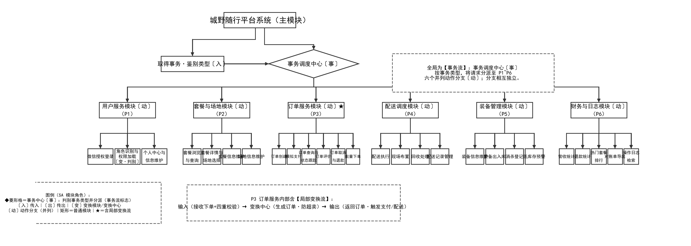
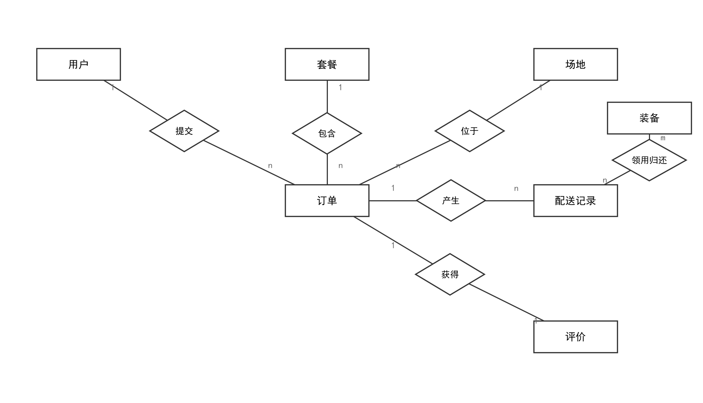
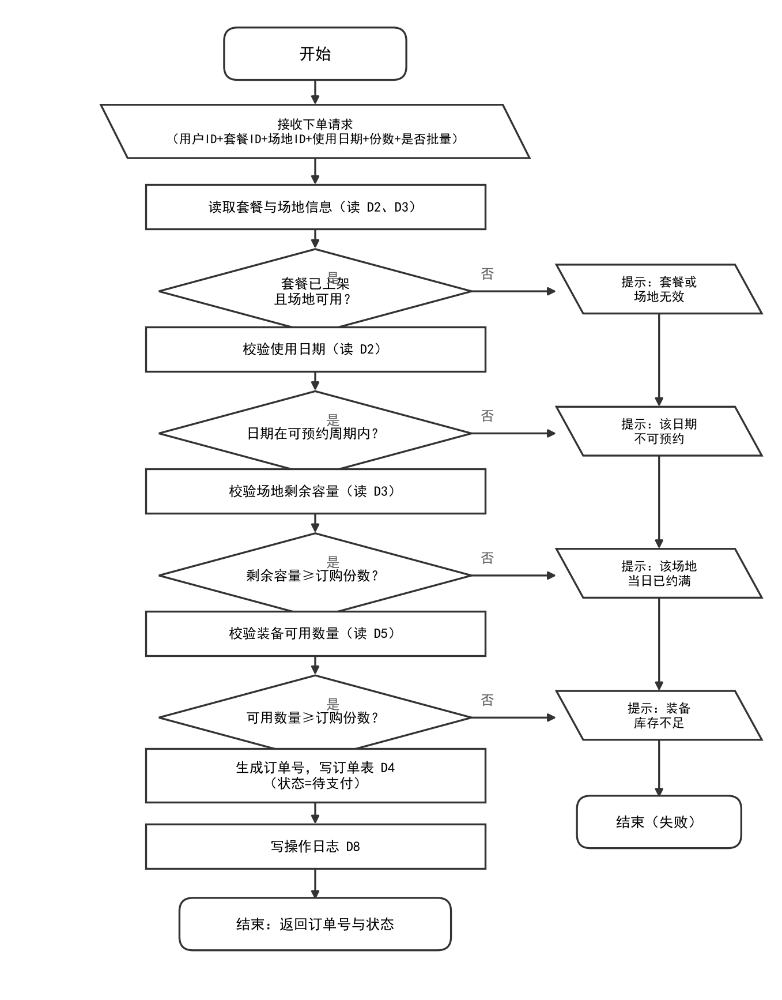
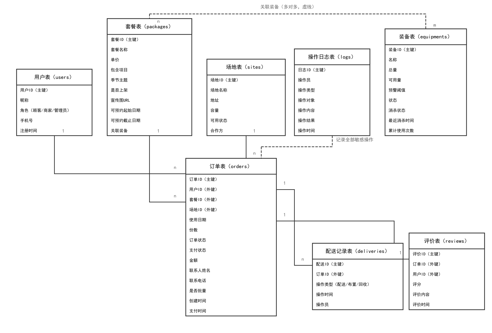

城野随行——系统设计图 draw.io 绘制说明

配套文档：《城野随行系统设计说明书 V1.0》 ｜ 绘制工具：draw.io（diagrams.net） ｜ 版本：V2.1（对齐 WorkBuddy 资料库《城野随行-需求文档》；V2.1 变更：图 2-1 按 SA 法重绘，区分变换流/事务流，并补 26 子功能角色映射表）

本说明覆盖 4 张设计图：① 系统软件结构图；② E-R 图；③ 订单创建算法流程图；④ 逻辑结构设计图（数据库表结构），全部对齐 WorkBuddy 资料库《城野随行-需求文档》的 P1~P6 加工划分、D1~D8 数据字典与订单状态机。每张图给出：题目描述（例题式场景，仿教材“学校-系-班级……”题干写法）、样例图（按模板风格绘制的对照样例）、绘制逻辑、draw.io 形状与样式参数、节点清单、连线清单、布局与防交叉要点、自检清单。按清单逐行画完即可，无需自由发挥。

〇、通用绘制规范（四张图都遵守）

- 画布：文件→新建→空白绘图（自定义页面大小，见各图建议）；开启网格吸附（对齐网格）。
- 底色与描边：所有图形白底 #FFFFFF、描边 #333333、线宽 1px——与需求规格说明书 DFD 图风格保持一致，全图不使用彩色填充。
- 字体：微软雅黑或宋体，节点文字 12px、连线标签 10px，文字一律水平居中；全图只用中文，不出现英文单词（逻辑结构设计图的表头可括注英文集合名，如“用户表（users）”；集合名/专有名词除外）。
- 连线：一律用直角折线（选中连线→右侧“格式”→线型选“正交”），禁止斜线、禁止连线穿过任何框、禁止交叉（E-R 图允许短直线段）。
- 导出：文件→导出为→PNG，缩放 200%、取消勾选“透明背景”，得到白底 PNG 后插入 Word。
- 图号说明：设计说明书若按模板补齐逻辑结构图，建议第 3 章图号顺序为——图 3-1 E-R 图、图 3-2 逻辑结构设计图、图 3-3 算法流程图（正文交叉引用同步修改，需要的话我可以帮你更新文档）。
# 一、图 2-1 系统软件结构图（SA 法：区分变换流 / 事务流）

1. 题目描述、样例图与绘制逻辑

题目描述（例题式）

城野随行平台系统按需求文档划分为六大业务模块：用户服务（P1）、套餐与场地（P2）、订单服务（P3）、配送调度（P4）、装备管理（P5）、财务与日志（P6）。用户服务模块提供微信授权登录、角色识别与权限加载、个人中心与信息维护；套餐与场地模块提供套餐浏览与查询、套餐详情与场地选择、套餐信息维护、场地信息维护；订单服务模块提供订单创建、模拟支付、订单查询与状态跟踪、订单评价、订单取消与退款、批量下单（B端）；配送调度模块提供配送执行、现场布置、回收处理、配送记录管理；装备管理模块提供装备信息维护、装备出入库、消杀登记、低库存预警；财务与日志模块提供营收统计、退款统计、热门套餐排行、对账单导出、操作日志检索。用模块结构树画出系统的软件结构图，并区分变换流与事务流。

样例图

绘制逻辑（SA 结构化设计）

先判定流型，再据此画结构图。判定结论：**全局为事务流，局部（P3 订单创建）为变换流**。

- 全局 = 事务流：系统入口接收多种"事务"（登录、浏览、下单、支付、查询、评价、退款、批量下单、配送推进、装备出入库/消杀、统计、日志检索），由"事务调度中心"按事务类型分派到 P1~P6 六个动作分支；动作分支彼此并列、相互独立，不存在"输入→加工→输出"的线性链，符合事务流特征。
- 局部 = 变换流：订单创建（P3.1）内部是标准变换流——输入（接收下单请求+四重校验：套餐上架/可预约周期/场地容量/装备库存）→ 变换中心（生成订单、占用容量与库存、防超卖写库 D4）→ 输出（返回订单号与待支付状态、触发模拟支付与配送任务）。
- 设计策略：先事务分析定全局骨架，再对 P3 做局部变换分析。
- **事务中心的醒目标注：事务调度中心画成菱形格**——菱形在结构化设计中专表"判别/分派"，与"按事务类型选路"的语义一致，是事务流的标志图元；其余模块一律矩形，形成"菱形=事务中心、矩形=普通模块"的直观对照。

2. 图元与样式

| 图元 | draw.io 形状 | 样式参数 |
| --- | --- | --- |
| 全部节点 | 左侧"常规"→ 矩形（方角，不要圆角） | fillColor=#FFFFFF;strokeColor=#333333;fontSize=12;whiteSpace=wrap;文字水平+垂直居中 |
| **事务调度中心（事务中心）** | 左侧"常规"→ **菱形**（rhombus）★关键区别图元 | 白底黑描边，约 400×110；文字居中，字加粗；菱形表"判别·分派"，是事务流的标志 |
| 控制层/模块节点 | 矩形，加粗（fontStyle=1） | 在节点文字后加 SA 角色标记：〔入〕〔事〕〔动〕，P3 加 ★ |
| 父子连线 | 连线（起点拖到父节点边缘，终点落到子节点边缘，保证吸附） | 正交折线；终点箭头选"开放式箭头(open)"；颜色 #333333；不设标签；**接入菱形时端点吸附到菱形顶点（上/下/左）** |
| 流型注解与图例 | 矩形 + 虚线边框（dashed=1;strokeColor=#666666） | 仅标注、不连线；align=left；fontSize=10 |

SA 角色标记约定（图例内容）：

| 标记 | 含义 |
| --- | --- |
| **◆ 菱形格 = 事务中心〔事〕** | 判别事务类型并分派，是事务流的标志图元 |
| 〔入〕传入模块 | 接收外部请求/数据，向上传递 |
| 〔出〕传出模块 | 向外部输出结果或写库 |
| 〔变〕变换模块/变换中心 | 加工处理（如 P3 订单创建） |
| 〔动〕动作分支 | 独立业务域，彼此并列 |
| 矩形 / ★ | 矩形 = 普通模块；★ = 含局部变换流的动作分支 |
| 〔变·判别〕 | 模块内含判别逻辑（如 P1 角色识别）：**仅文字标注，形状仍为矩形**——菱形只保留给事务中心，保证"全图唯一菱形 = 事务流标志" |

> **菱形使用约定**：结构图（SC）教材中模块一律矩形，菱形专表"判别·分派"。本图仅在事务中心使用菱形（强调性约定）；子功能层即使含判别逻辑（如角色识别、四重校验），也只在文字上标注，不改形状——否则菱形泛滥会稀释事务流标志，且传入/传出模块画菱形无教材依据。判别的完整过程由图 3-3（订单创建算法流程图）等下层流程图表达。

3. SA 拆解：事务类型分派表（事务中心如何分派）

| 事务类型（鉴别依据） | 分派目标（动作分支） |
| --- | --- |
| 登录 / 鉴权 / 用户信息类 | P1 用户服务 |
| 套餐 / 场地浏览与维护类 | P2 套餐与场地 |
| 下单 / 支付 / 查询 / 评价 / 退款 / 批量类 | P3 订单服务（含局部变换流） |
| 配送 / 布置 / 回收推进类 | P4 配送调度 |
| 装备出入库 / 消杀 / 预警类 | P5 装备管理 |
| 统计 / 导出 / 日志检索类 | P6 财务与日志 |

4. SA 拆解：26 个子功能的 SA 角色映射表

| 动作分支 | 子功能 | SA 角色 | 流型归属 | 说明 |
| --- | --- | --- | --- | --- |
| P1 用户服务 | 微信授权登录 | 〔入〕传入 | 事务流分支 | 接收微信授权凭据换取 openid |
| P1 用户服务 | 角色识别与权限加载 | 〔变·判别〕变换 | 事务流分支 | 按 C端/B端/管理员 判别并分派权限；**形状仍为矩形，仅文字标注判别语义**（菱形保留给事务中心） |
| P1 用户服务 | 个人中心与信息维护 | 〔出〕传出 | 事务流分支 | 写用户信息 |
| P2 套餐与场地 | 套餐浏览与查询 | 〔入〕传入 | 事务流分支 | 只读查询 |
| P2 套餐与场地 | 套餐详情与场地选择 | 〔入〕传入 | 事务流分支 | 只读查询/选择 |
| P2 套餐与场地 | 套餐信息维护 | 〔出〕传出 | 事务流分支 | B 端写库 |
| P2 套餐与场地 | 场地信息维护 | 〔出〕传出 | 事务流分支 | B 端写库 |
| P3 订单服务 | 订单创建 | 〔变〕变换中心 ★ | 局部变换流 | 输入→变换中心→输出；防超卖 |
| P3 订单服务 | 模拟支付 | 〔出〕传出 | 事务流分支 | 调外部模拟支付接口 |
| P3 订单服务 | 订单查询与状态跟踪 | 〔入〕传入 | 事务流分支 | 只读查询 |
| P3 订单服务 | 订单评价 | 〔出〕传出 | 事务流分支 | 写评价（重复评价返回 4009） |
| P3 订单服务 | 订单取消与退款 | 〔出〕传出 | 事务流分支 | 写库/退款 |
| P3 订单服务 | 批量下单（B端） | 〔变〕变换 | 局部变换流 | 逐份占用容量与库存，同一变换逻辑 |
| P4 配送调度 | 配送执行 | 〔变〕变换 | 事务流分支 | 状态推进+写配送记录 D6 |
| P4 配送调度 | 现场布置 | 〔变〕变换 | 事务流分支 | 状态推进+写配送记录 D6 |
| P4 配送调度 | 回收处理 | 〔变〕变换 | 事务流分支 | 状态推进+写配送记录 D6 |
| P4 配送调度 | 配送记录管理 | 〔出〕传出 | 事务流分支 | 写/查配送记录 |
| P5 装备管理 | 装备信息维护 | 〔出〕传出 | 事务流分支 | 写装备信息 |
| P5 装备管理 | 装备出入库 | 〔变〕变换 | 事务流分支 | 库存占用/释放（DF011） |
| P5 装备管理 | 消杀登记 | 〔出〕传出 | 事务流分支 | 写消杀状态 |
| P5 装备管理 | 低库存预警 | 〔出〕传出 | 事务流分支 | 读库存→比较阈值→输出预警 |
| P6 财务与日志 | 营收统计 | 〔入〕传入 | 事务流分支 | 只读统计 |
| P6 财务与日志 | 退款统计 | 〔入〕传入 | 事务流分支 | 只读统计 |
| P6 财务与日志 | 热门套餐排行 | 〔入〕传入 | 事务流分支 | 只读统计 |
| P6 财务与日志 | 对账单导出 | 〔出〕传出 | 事务流分支 | 输出对账单 |
| P6 财务与日志 | 操作日志检索 | 〔入〕传入 | 事务流分支 | 只读检索 D8 |

5. 节点清单（38 个：L0 主模块 1 + 控制层 2 + 动作分支 6 + 子功能 26 + 注解 2 + 图例 1）

| 层级 | 节点文字 | 建议位置 |
| --- | --- | --- |
| L0 | 城野随行平台系统（主模块） | 顶部居中，矩形 |
| 控制层 | 取得事务·鉴别类型〔入〕 | 第二行左，矩形 |
| 控制层 | 事务调度中心〔事〕 | 第二行中，**菱形（约 400×110）** |
| L1 | 用户服务模块〔动〕（P1） | 第三行左起第 1 |
| L1 | 套餐与场地模块〔动〕（P2） | 第三行左起第 2 |
| L1 | 订单服务模块〔动〕★（P3） | 第三行左起第 3 |
| L1 | 配送调度模块〔动〕（P4） | 第三行左起第 4 |
| L1 | 装备管理模块〔动〕（P5） | 第三行左起第 5 |
| L1 | 财务与日志模块〔动〕（P6） | 第三行左起第 6 |
| L2 | P1：微信授权登录 / 角色识别与权限加载〔变·判别〕 / 个人中心与信息维护 | 一排 3 个（宽 112） |
| L2 | P2：套餐浏览与查询 / 套餐详情与场地选择 / 套餐信息维护 / 场地信息维护 | 一排 4 个 |
| L2 | P3：订单创建 / 模拟支付 / 订单查询与状态跟踪 / 订单评价 / 订单取消与退款 / 批量下单 | 一排 6 个 |
| L2 | P4：配送执行 / 现场布置 / 回收处理 / 配送记录管理 | 一排 4 个 |
| L2 | P5：装备信息维护 / 装备出入库 / 消杀登记 / 低库存预警 | 一排 4 个 |
| L2 | P6：营收统计 / 退款统计 / 热门套餐排行 / 对账单导出 / 操作日志检索 | 一排 5 个 |
| 注解 | "全局为【事务流】……" | 右上空白区 |
| 注解 | "P3 订单服务内部含【局部变换流】……" | P3 子功能下方 |
| 图例 | SA 模块角色标记说明 | 左下空白区 |

注：L2 子功能节点尺寸约 60~112 宽×60 高（按每排数量自适应），L1 约 250×60，控制层：取得事务 280×60、**事务调度中心为菱形约 400×110**，L0 约 320×60。画布建议 2900×820。

6. 连线清单（35 条）

| 编号 | 起点 → 终点 | 说明 |
| --- | --- | --- |
| E1 | 主模块 → 取得事务·鉴别类型〔入〕 | 控制调用；从主模块底部偏左引出（避免与 E2 竖线重叠） |
| E2 | 主模块 → 事务调度中心〔事〕 | 控制调用；**终点吸附到菱形上顶点** |
| E3 | 取得事务 → 事务调度中心 | 事务类型回传（水平线）；**终点吸附到菱形左顶点** |
| E4~E9 | 事务调度中心 → P1~P6（6 条） | 事务分派；**起点从菱形下顶点引出**，共用一条水平分派总线（y=255），再到各模块顶部下落 |
| E10~E35 | 各动作分支 → 各自的 L2 子功能（26 条，逐条连接） | 3+4+6+4+4+5 |

7. 布局与自检

- 六个动作分支等距水平排布（中心间距 420px），模块与其 L2 子功能垂直对齐成列；分派总线走 y=255 空白带，与任何框不相交。
- 菱形事务中心约 400×110，位于画布中轴偏右；其上/下/左三个顶点分别接 E2/E4~E9/E3 三组连线，右顶点留空；菱形与右上注解之间留 ≥40px 间距。
- 控制层连线在 y=110/180 两个水平带内完成，主模块底部两条引出线错开 x 位置（偏左/偏右），互不重叠、不交叉。
- 两条流型注解与图例均放在空白区，不与任何连线、节点重叠。
- 自检：①数节点 38 个（L0 1+控制层 2+L1 6+L2 26+注解 2+图例 1）、连线 35 条（3+6+26）；②**全图有且仅有 1 个菱形（事务调度中心），其余全为矩形**；③事务调度中心到 6 个模块的分派线从菱形下顶点出发、经同一水平总线，无交叉；④无斜线、连线不穿过任何框；⑤文字全部居中且无英文（SA 标记〔〕除外）；⑥箭头方向一律自上而下（E3 除外，为水平回传）；⑦图例与两条流型注解齐备，图例首行注明"◆菱形格＝事务中心"。
# 二、图 3-1 数据库概念结构设计（E-R 图，Chen 风格）

1. 题目描述、样例图与绘制逻辑

题目描述（例题式）

城野随行平台中有用户、套餐、场地、订单、配送记录、评价、装备七类数据。每个用户可提交多个订单，每个订单只属于一个用户；每种套餐可被包含在多个订单中，每个订单只对应一种套餐；每个场地可位于多个订单中，每个订单只位于一个场地；每个订单可产生多条配送记录，每条配送记录只属于一个订单；每个订单至多获得一条评价，每条评价只对应一个订单；多种装备可经多种套餐关联，并在配送记录中领用归还。用 E-R 图画出该概念模型。

样例图

参照模板“用户-订单-支付”示例（矩形实体+菱形联系+1/n 标注）：以“订单”为中心实体，7 个实体、6 个联系。不画属性椭圆（与模板示例一致，属性放到逻辑结构图中表达）。每条联系画两段线：实体→菱形、菱形→实体，并在每段线两端分别标注基数（1、n、m）。

2. 图元与样式

| 图元 | draw.io 形状 | 样式参数 |
| --- | --- | --- |
| 实体（7 个） | 左侧“常规”→ 矩形 | 白底 #FFFFFF；描边 #333333；约 140×55；文字 12px 居中 |
| 联系（6 个） | 左侧“常规”→ 菱形 | 白底；约 110×70；菱形内写联系名（2~4 字） |
| 连线（12 段） | 直线（用“正交”亦可，模板示例为直线段，推荐直接拖拽直线保持短而直） | 无箭头实线；颜色 #333333 |
| 基数标注 | 在连线上双击添加文字，或连线右键→“编辑标签” | 10px，灰色 #666666；放在连线靠近实体一端 |

3. 节点清单（13 个）

| 类型 | 节点文字 | 建议位置 |
| --- | --- | --- |
| 实体 | 订单 | 画布正中（枢纽实体） |
| 实体 | 用户 | 订单左上 |
| 实体 | 套餐 | 订单正上 |
| 实体 | 场地 | 订单右上 |
| 实体 | 配送记录 | 订单右侧 |
| 实体 | 评价 | 订单右下 |
| 实体 | 装备 | 画布最右（与配送记录联系） |
| 联系 | 提交 | 用户与订单之间 |
| 联系 | 包含 | 套餐与订单之间 |
| 联系 | 位于 | 场地与订单之间 |
| 联系 | 产生 | 订单与配送记录之间 |
| 联系 | 获得 | 订单与评价之间 |
| 联系 | 领用归还 | 装备与配送记录之间 |

4. 连线清单（12 段，每条联系 2 段）

| 联系 | 第一段（实体→菱形） | 第二段（菱形→实体） | 基数标注 |
| --- | --- | --- | --- |
| 提交 | 用户 → 提交 | 提交 → 订单 | 用户端标 1，订单端标 n |
| 包含 | 套餐 → 包含 | 包含 → 订单 | 套餐端标 1，订单端标 n |
| 位于 | 场地 → 位于 | 位于 → 订单 | 场地端标 1，订单端标 n |
| 产生 | 订单 → 产生 | 产生 → 配送记录 | 订单端标 1，配送记录端标 n |
| 获得 | 订单 → 获得 | 获得 → 评价 | 两端均标 1 |
| 领用归还 | 装备 → 领用归还 | 领用归还 → 配送记录 | 装备端标 m，配送记录端标 n |

5. 布局与自检

- 操作日志（D8）为审计数据存储，不参与业务联系，E-R 图不画该实体（逻辑结构图中以虚线弱关联表达）。
- 六个联系菱形全部挂在“订单”周围呈放射状，两段线取最短直线，天然无交叉。
- “装备→领用归还→配送记录”这一条不经过订单，放在画布右侧独立成行，避免与“产生”连线打架。
- 画布建议 1400×900；实体/菱形间距≥120，留出基数标注位置。
- 自检：①7 实体 6 菱形 12 段线；②每段线两端都有基数标注；③菱形内是动词短语、矩形内是名词；④无箭头、无交叉。
# 三、图 3-3 订单创建（P3.1）算法流程图

1. 题目描述、样例图与绘制逻辑

题目描述（例题式）

用户提交下单请求（含用户 ID、套餐 ID、场地 ID、使用日期、份数、是否批量）后，系统依次校验：套餐和场地是否有效、使用日期是否在可预约周期内、场地当日剩余容量是否充足、装备可用数量是否充足。任何一项校验不通过，则输出对应的失败提示并结束；全部通过则生成订单号，在事务中写入订单表（状态=待支付）并记录操作日志，最后返回订单号与订单状态。用流程图画出该订单创建算法。

样例图

按你一贯的流程图规范（沿用 L5/L6 课程案例样式）：白底深灰描边；开始/结束用圆角矩形，输入/输出用平行四边形，处理用矩形，判断用菱形；主流程竖直居中，四个失败分支全部放右侧一列并串联汇入“结束（失败）”，主链与失败链互不交叉；判断分支用“是/否”标签（中性灰）。

2. 图元与样式

| 图元 | draw.io 形状 | 样式参数 |
| --- | --- | --- |
| 开始/结束 | 圆角矩形（拖入后圆角默认保留） | rounded=1;fillColor=#FFFFFF;strokeColor=#333333；约 160×50 |
| 处理 | 矩形（方角） | rounded=0；约 240×55 |
| 判断 | 菱形 | 约 220×90；文字 11px 可两行（用 Shift+Enter 换行） |
| 输入/输出 | 形状库“流程图”→ 手动输入（平行四边形） | 约 260×55；提示语用“流程图→显示”亦可 |
| 连线 | 正交折线 | 颜色 #333333；箭头样式选“块状箭头(classic)”；标签“是/否”10px 灰色 #666666 |

3. 节点清单（18 个）

| 编号 | 节点文字 | 形状 | 位置 |
| --- | --- | --- | --- |
| N1 | 开始 | 圆角矩形 | 主列顶部 |
| N2 | 接收下单请求（用户ID+套餐ID+场地ID+使用日期+份数+是否批量） | 平行四边形 | 主列第 2 层 |
| N3 | 读取套餐与场地信息（读 D2、D3） | 矩形 | 主列第 3 层 |
| N4 | 套餐已上架且场地可用？ | 菱形 | 主列第 4 层 |
| N5 | 校验使用日期（读 D2） | 矩形 | 主列第 5 层 |
| N6 | 日期在可预约周期内？ | 菱形 | 主列第 6 层 |
| N7 | 校验场地剩余容量（读 D3） | 矩形 | 主列第 7 层 |
| N8 | 剩余容量≥订购份数？ | 菱形 | 主列第 8 层 |
| N9 | 校验装备可用数量（读 D5） | 矩形 | 主列第 9 层 |
| N10 | 可用数量≥订购份数？ | 菱形 | 主列第 10 层 |
| N11 | 生成订单号，写订单表 D4（状态=待支付） | 矩形 | 主列第 11 层 |
| N12 | 写操作日志 D8 | 矩形 | 主列第 12 层 |
| N13 | 结束：返回订单号与状态 | 圆角矩形 | 主列底部 |
| N14 | 提示：套餐或场地无效 | 平行四边形 | 右侧失败列第 1 个（与 N4 同行） |
| N15 | 提示：该日期不可预约 | 平行四边形 | 右侧失败列第 2 个（与 N6 同行） |
| N16 | 提示：该场地当日已约满 | 平行四边形 | 右侧失败列第 3 个（与 N8 同行） |
| N17 | 提示：装备库存不足 | 平行四边形 | 右侧失败列第 4 个（与 N10 同行） |
| N18 | 结束（失败） | 圆角矩形 | 右侧失败列底部（与 N13 同行） |

4. 连线清单（20 条）

| 组 | 连线 | 标签 |
| --- | --- | --- |
| 主链 12 条 | N1→N2→N3→N4→N5→N6→N7→N8→N9→N10→N11→N12→N13 | 菱形出口 N4/N6/N8/N10 的向下分支标“是”（灰），其余不加标签 |
| 否分支 4 条 | N4→N14、N6→N15、N8→N16、N10→N17（水平向右） | 标“否”（灰） |
| 失败链 4 条 | N14→N15→N16→N17（右侧列垂直串联）→N18 | 无标签；N17→N18 为一条长直线 |

5. 布局与防交叉要点

- 主列宽约 300、水平居中；失败列整体在主列右侧约 380 处，宽度约 280。
- 四个“否”分支全部水平向右、互不相交；失败提示靠垂直串联汇入 N18，避免四条斜线交叉冲向同一个框。
- 菱形的“是”出口一律从底边出、向下走；“否”出口一律从右侧顶点出、向右走——方向固定后全图不可能交叉。
- 画布建议 1000×1600；导出 PNG 后按宽约 10cm 插入 Word。
6. 自检清单

- ①18 节点 20 连线；②四个失败原因与判断一一对应且顺序不乱（有效性→日期→容量→装备）；③是/否标签齐全、颜色 #666666；④所有连线正交、零交叉、不穿框；⑤全图中文、无英文。
# 四、图 3-2 逻辑结构设计图（数据库表结构，中文表达，crow's foot）

1. 题目描述、样例图与绘制逻辑

题目描述（例题式）

将 E-R 图转换为关系模型：用户、套餐、场地、订单、装备、配送记录、评价、操作日志分别对应一张二维表。订单表通过用户 ID、套餐 ID、场地 ID 三个外键分别关联用户表、套餐表、场地表；配送记录表和评价表通过订单 ID 外键关联订单表；装备与套餐之间为多对多联系，通过套餐表中的“关联装备”字段表达；操作日志表独立记录全部敏感操作。主键加下划线（标“主键”）、外键标“外键”，用 crow's foot（鸡爪线）画出逻辑结构设计图。全部表名与字段名使用中文。

样例图

参照模板“reservation/reader/book”示例：用 draw.io 的 ER 表格形状画出 8 张集合表（表头=中文表名并括注英文集合名，行=中文字段），主键标“（主键）”并加下划线、外键标“（外键）”，表与表之间用“鸡爪线（crow's foot）”表达一对多。orders（订单表）居中作枢纽，用户表、套餐表、场地表从上方接入，配送记录表、评价表从下方接入。

2. 图元与样式

| 图元 | draw.io 形状 | 样式参数 |
| --- | --- | --- |
| 集合表（8 个） | 左侧形状库搜索“ER”→ Entity（表头+多行字段）；或插入→表格合并为 1 列 | 表头行写“中文表名（英文集合名）”，如“订单表（orders）”；字段行写中文字段名，11px 左对齐；白底 #FFFFFF、描边 #333333；表宽约 240 |
| 主键 | 字段行文字，如“订单ID（主键）” | 加粗 + 下划线（选中文字按 Ctrl+U），与模板示例一致 |
| 外键 | 字段行文字，如“用户ID（外键）” | 后缀“（外键）”（或前缀 FK），不加下划线 |
| 一对多连线 | 从主表边缘拖连线到从表边缘 | 正交折线；选中连线→格式→“起点/终点”箭头下拉里选 ER 样式：1 端选“一(one)”、多端选“多(many/鸡爪)”；颜色 #333333 |
| 弱关联虚线 | 同上 | 虚线（Dashed 勾选），不设箭头 |

3. 表与字段清单（8 张表，全中文）

| 表名（表头写法） | 字段（按行从上到下；加粗下划线=主键，“（外键）”=外键） |
| --- | --- |
| 用户表（users） | 用户ID（主键）｜昵称｜角色（顾客/商家/管理员）｜手机号｜注册时间 |
| 套餐表（packages） | 套餐ID（主键）｜套餐名称｜单价｜包含项目｜季节主题｜是否上架｜宣传图URL｜可预约起始日期｜可预约截止日期｜关联装备 |
| 场地表（sites） | 场地ID（主键）｜场地名称｜地址｜容量｜可用状态｜合作方 |
| 订单表（orders） | 订单ID（主键）｜用户ID（外键）｜套餐ID（外键）｜场地ID（外键）｜使用日期｜份数｜订单状态｜支付状态｜金额｜联系人姓名｜联系电话｜是否批量｜创建时间｜支付时间 |
| 装备表（equipments） | 装备ID（主键）｜名称｜总量｜可用量｜预警阈值｜状态｜消杀状态｜最近消杀时间｜累计使用次数 |
| 配送记录表（deliveries） | 配送ID（主键）｜订单ID（外键）｜操作类型（配送/布置/回收）｜操作时间｜操作员 |
| 评价表（reviews） | 评价ID（主键）｜订单ID（外键）｜用户ID（外键）｜评分｜评价内容｜评价时间 |
| 操作日志表（logs） | 日志ID（主键）｜操作员｜操作类型｜操作对象｜操作内容｜操作结果｜操作时间 |

4. 连线清单（6 条实线 + 1 条虚线）

| 编号 | 起点（1 端）→ 终点（多端） | 样式 | 说明 |
| --- | --- | --- | --- |
| C1 | 用户表 → 订单表 | 一对多 | 订单表.用户ID 外键 |
| C2 | 套餐表 → 订单表 | 一对多 | 订单表.套餐ID 外键 |
| C3 | 场地表 → 订单表 | 一对多 | 订单表.场地ID 外键 |
| C4 | 订单表 → 配送记录表 | 一对多 | 配送记录表.订单ID 外键 |
| C5 | 订单表 → 评价表 | 一对一 | 两端都选“一”；评价表.订单ID 外键 |
| C6 | 装备表 ↔ 套餐表 | 多对多（虚线） | 套餐表.关联装备 字段引用；虚线+两端“多”，线旁标“关联装备” |
| C7 | 操作日志表 —（虚线）— 各业务表 | 虚线无箭头 | 仅画一条虚线指向订单表并加文字“记录全部敏感操作”即可，不必逐表连线 |

5. 布局与防交叉要点

- 订单表（字段最多、最高）放画布中轴；用户表、套餐表、场地表从左到右依次排在上方一列；装备表排右上角；配送记录表、评价表排订单表右下方；操作日志表排上方中部或右侧独立放置。
- 连线尽量“从表底部边缘出、进订单表左侧边缘”，同侧多条线并行不交叉；三张上方来源表按用户/套餐/场地顺序接入订单表左侧边缘的上/中/下三个锚点。
- 装备表→套餐表的虚线走画布最顶部外围通道（先向上再横向再向下），避开中间区域（照样例图 4 的走线）。
- 画布建议 1600×1200；订单表很高，注意与其他表垂直间距≥80。
6. 自检清单

- ①8 张表齐全、中文字段与《系统设计说明书》表 3-1 一一对应；②每张表主键恰好 1 个且加粗下划线；③订单表 3 个外键、配送记录表 1 个外键、评价表 2 个外键都标了“（外键）”；④C1~C4 四条实线的鸡爪端都在“多”端（C5 两端都是“一”）；⑤零交叉、不穿框；⑥全图中文，表头仅括注英文集合名。
附：建议绘制顺序与时间分配

- 第 1 步：软件结构图（约 40 分钟）——先画 6 个 L1 模块并横向等距，再画 L0 与 L2，最后统一连线，连线可框选一批用“编辑样式”批量刷成开放式箭头。
- 第 2 步：E-R 图（约 30 分钟）——先定“订单”中心，菱形放射布置，最后补基数标注。
- 第 3 步：逻辑结构图（约 60 分钟）——先拖 8 个 ER Entity 并填中文字段，再布位，最后连线设鸡爪。
- 第 4 步：算法流程图（约 45 分钟）——先铺主链 13 个节点，再放右侧失败列 5 个，最后连线加是/否标签。
- 全部画完后：每张图过一遍自检清单 → 文件→导出为 PNG（缩放 200%、白底）→ 告诉我，我把 4 张图替换进《城野随行系统设计说明书 V1.0》并同步调整正文图号。
