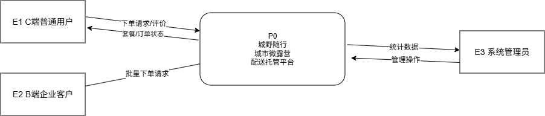
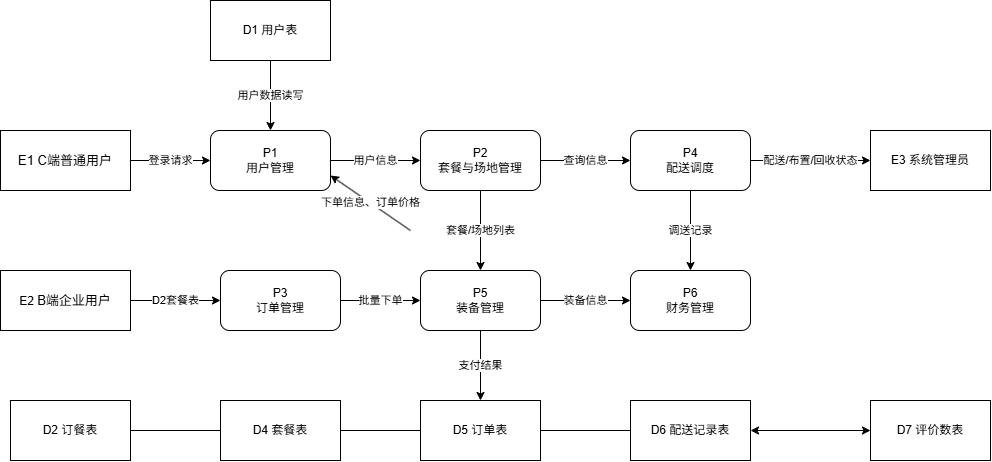
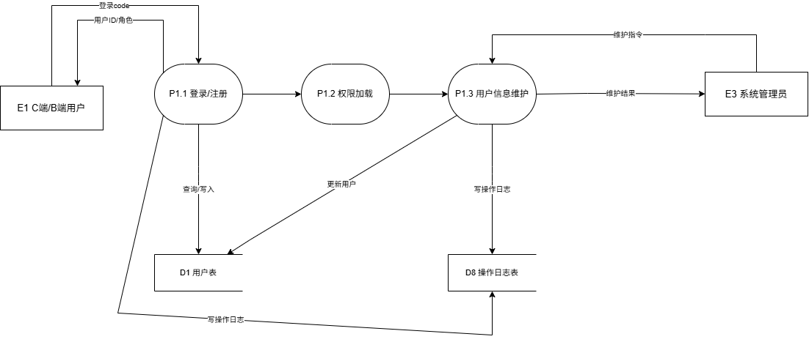
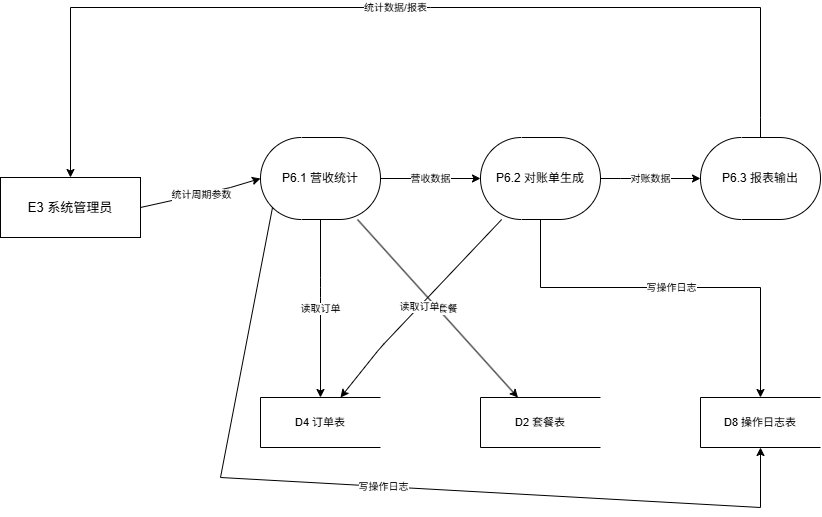
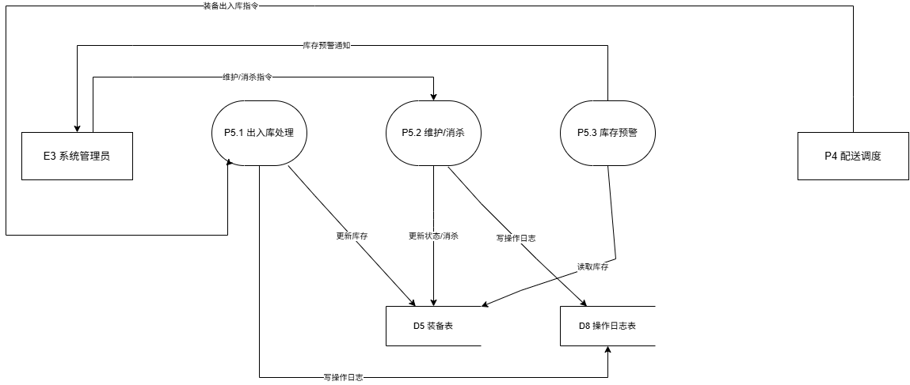
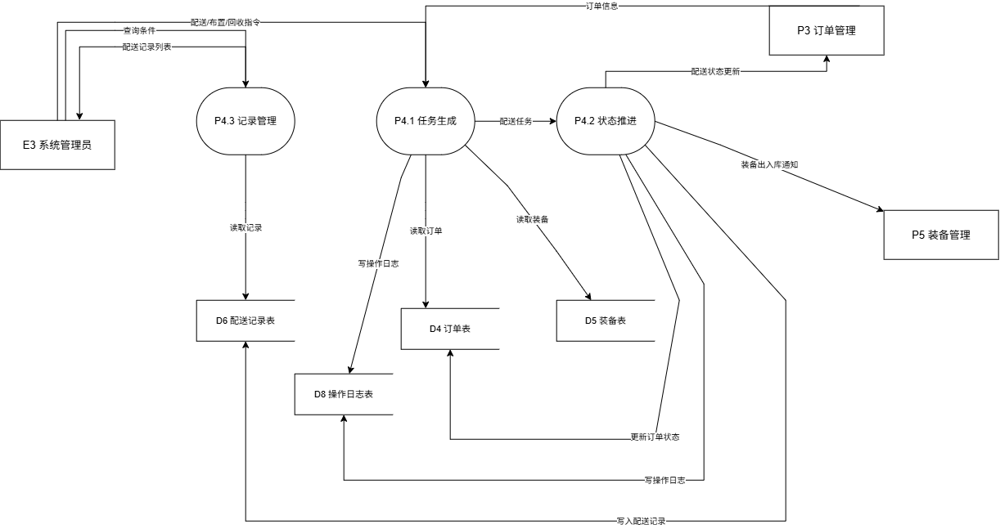
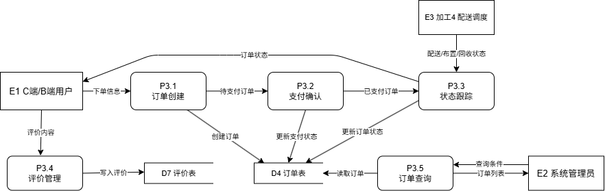
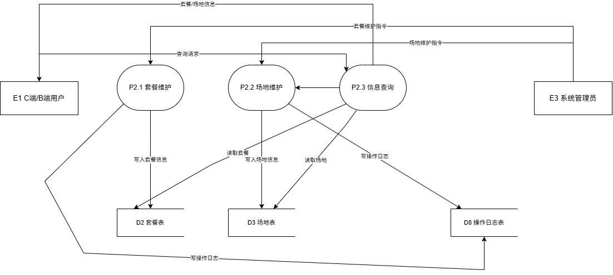

城野随行——季节限定城市微露营一站式配送托管平台

需求规格说明书

报告编号：【CYSX-2026-10-17】

编制单位：【城野随行项目组】

编制日期：【2026 年 10 月 17 日】

版本号：【V2.2】

目 录

## 1.	引言

## 1.1	项目背景

## 1.2	文档目的

## 1.3	范围

## 1.4	参考文档

## 2	总体描述

## 2.1	功能概述

## 2.2	用户特征

## 2.3	运行环境

## 3	系统需求

## 3.1	功能需求

## 3.2	非功能需求

## 3.3	接口需求

## 4	验收标准

## 5	附录

## 签字确认页

参与编写本方案设计的人员

| 组  长： | @lian-hash | 引言，系统需求 |
| --- | --- | --- |
| 成员： | @teammate-c | 总体描述，系统需求 |
| 成员： | @teammate-b | 验收标准，系统需求 |
| 成员： |  |  |

## 1. 引言

### 1.1 项目背景

随着城市年轻人对户外休闲需求的增长，露营成为热门社交方式。然而传统露营存在装备购置成本高、携带运输麻烦、搭建收纳耗时、场地选择受限等痛点。城野随行平台通过"微信小程序下单+全城定点配送+现场布置+用完回收"的闭环服务模式，降低露营门槛，让用户无需购买装备即可享受露营体验。

本系统依赖微信开放平台提供登录与支付能力，依赖微信云开发提供计算与存储服务，与城市合规场地合作方建立场地白名单机制。

### 1.2 文档目的

本文档为"城野随行——季节限定城市微露营一站式配送托管平台"的需求规格说明书，旨在明确系统的功能需求、非功能需求、接口需求及验收标准，作为项目设计、开发、测试及验收的基准，统一各方对需求的理解。

### 1.3 范围

#### 1.3.1 功能范围

系统需支持用户管理、套餐与场地管理、订单管理、配送调度、装备管理、财务管理六大核心功能，覆盖从用户浏览下单到配送回收再到评价反馈的全流程。

暂不支持真实资金交易（采用模拟支付）、暂不支持配送人员移动端APP（由管理员后台统一模拟操作）、暂不支持多城市跨区域调度。

#### 1.3.2 业务范围

C端普通用户（18-35岁城市年轻人）、B端企业客户（团建需求）、系统管理员（平台运营人员）。

从用户浏览套餐、选择场地、下单支付、配送布置、使用回收、评价反馈到财务统计的完整业务闭环。

### 1.4 参考文档

《城野随行可行性研究报告》《GB/T 9385-2008 计算机软件需求规格说明规范》《微信小程序设计指南》《微信小程序开发文档》《微信云开发文档》《关于推动露营旅游休闲健康有序发展的指导意见》（文旅部等14部委，2022年）

## 2. 总体描述

### 2.1 功能概述

城野随行平台以微信小程序为核心载体，配套轻量Web管理后台，实现露营套餐浏览、在线下单、模拟支付、配送调度、装备管理与回收消杀、评价反馈与财务统计的全流程管理。系统采用模拟运营模式，不涉及真实资金交易，配送、布置、回收环节由系统管理员在后台点击按钮模拟推进。业务目标：用户从浏览到下单操作步骤≤3步；单套装备循环复用次数≥30次；节假日订单按时交付率≥95%；订单全流程状态可追溯率100%。

### 2.2 用户特征

表2-1 系统用户特征描述

| 用户角色 | 职责描述 | 技术能力要求 |
| --- | --- | --- |
| C端普通用户 | 18-35岁城市年轻人：浏览套餐与场地、下单支付、查看订单进度、提交评价 | 具备基础微信操作能力，无需专业户外知识 |
| B端企业客户 | 企业HR/行政：批量下单、查看团建订单、导出对账单（模拟结算） | 基础计算机与微信操作能力 |
| 系统管理员 | 平台运营人员：轮播图与套餐上下架、场地白名单维护、订单与退款处理、配送/布置/回收状态模拟推进、装备库存与消杀记录、营收统计、用户与权限管理 | 中级IT技能，熟悉Web后台操作 |

### 2.3 运行环境

硬件环境：服务端采用微信云开发（云函数+云数据库+云存储），无需自建服务器，云函数运行内存1GB、云数据库容量2GB、云存储50GB（按云开发套餐申请）；客户端为用户智能手机（iOS 13+ / Android 9+，内存≥2GB，需安装微信8.0及以上版本）；管理端为普通PC（CPU≥4核、内存≥8GB、显示器分辨率≥1366×768）。

软件环境：客户端为微信8.0及以上版本（iOS/Android）；管理端为Chrome 100+ / Edge 100+浏览器；服务端为微信云开发Node.js 16运行环境（云函数）；数据库为云开发NoSQL文档型数据库；管理端前端采用Vue3 + Element Plus。

## 3. 系统需求

### 3.1 功能需求

#### 3.1.1 分层数据流图（DFD）

通过分层数据流图描述城野随行平台的数据流动及处理过程，包含顶层DFD（上下文图）、0层DFD及P3订单管理加工的底层DFD，其余加工的底层DFD按同一方法展开。

##### （1）顶层DFD（上下文图）

目的：展示城野随行系统与外部实体的交互，明确系统边界。

外部实体：E1 C端普通用户、E2 B端企业客户、E3 系统管理员

顶层DFD图如下图3-1所示：

图3-1 城野随行顶层DFD图

##### （2）0层DFD

目的：将顶层DFD的“系统”分解为核心加工过程，展示主要数据处理逻辑。

核心加工：P1.用户管理、P2.套餐与场地管理、P3.订单管理、P4.配送调度、P5.装备管理、P6.财务管理

数据存储：D1.用户表、D2.套餐表、D3.场地表、D4.订单表、D5.装备表、D6.配送记录表、D7.评价表、D8.操作日志表

0层DFD图如下图3-2所示：

##### （3）底层DFD（以"P3.订单管理"为例）

目的：细化订单管理加工的子过程，明确具体处理步骤。

#### 3.1.2 数据字典

#### 说明：定义数据流图中所有数据元素、数据流、数据存储、外部实体的详细信息，确保数据描述的一致性。

##### （1）数据项

| 编号 | 名称 | 类型 | 长度 | 取值范围 | 描述 |
| --- | --- | --- | --- | --- | --- |
| DE001 | 用户ID | 字符串 | 32 | 微信openid | 唯一标识用户 |
| DE002 | 用户昵称 | 字符串 | 50 | 任意字符 | 用户微信昵称 |
| DE003 | 用户角色 | 字符串 | 10 | C端/B端/管理员 | 用户身份类型，决定功能权限 |
| DE004 | 套餐ID | 字符串 | 20 | 字母+数字 | 唯一标识套餐 |
| DE005 | 套餐名称 | 字符串 | 50 | 任意字符 | 套餐显示名称 |
| DE006 | 套餐价格 | 数值 | 10,2 | ≥0 | 套餐租赁价格（元） |
| DE007 | 套餐包含物品 | 字符串 | 200 | 非空 | 套餐内装备与耗材清单（如折叠桌椅、氛围灯、野餐垫） |
| DE008 | 季节主题 | 字符串 | 20 | 春日/夏日/秋日/冬日/节日限定 | 套餐所属季节或节日主题 |
| DE009 | 场地ID | 字符串 | 20 | 字母+数字 | 唯一标识场地 |
| DE010 | 场地名称 | 字符串 | 50 | 任意字符 | 场地显示名称 |
| DE011 | 场地容量 | 整数 | 4 | ≥1 | 该场地同一使用日期可容纳的最大订单份数 |
| DE012 | 订单ID | 字符串 | 20 | 字母+数字 | 唯一标识订单 |
| DE013 | 订单状态 | 字符串 | 20 | 待支付/已支付/配送中/布置中/使用中/已回收/已完成/已取消 | 订单当前状态 |
| DE014 | 支付状态 | 字符串 | 10 | 未支付/已支付/已退款 | 支付状态 |
| DE015 | 订单金额 | 数值 | 10,2 | ≥0 | 订单应付金额（元） |
| DE016 | 装备ID | 字符串 | 20 | 字母+数字 | 唯一标识装备 |
| DE017 | 装备状态 | 字符串 | 10 | 可用/已借出/维修中/已报废 | 装备当前状态 |
| DE018 | 装备可用数量 | 整数 | 6 | ≥0 | 该装备当前可出租的可用数量 |
| DE019 | 装备预警阈值 | 整数 | 6 | ≥0 | 触发装备库存预警的最低可用数量（如：5） |
| DE020 | 配送记录ID | 字符串 | 20 | 字母+数字 | 唯一标识配送记录 |
| DE021 | 评价ID | 字符串 | 20 | 字母+数字 | 唯一标识评价 |
| DE022 | 评分 | 整数 | 1 | 1-5 | 用户评分星级 |
| DE023 | 联系电话 | 字符串 | 20 | 11位手机号或含区号座机 | 用户或企业联系人电话 |
| DE024 | 使用日期 | 日期 | - | YYYY-MM-DD | 套餐使用日期 |
| DE025 | 操作时间 | 日期时间 | - | YYYY-MM-DD HH:MM:SS | 记录操作时间 |
| DE026 | 消杀状态 | 字符串 | 10 | 未消杀/已消杀 | 装备回收后的消杀处理状态 |

##### （2）数据流

| 编号 | 名称 | 来源 | 去向 | 组成元素 | 描述 |
| --- | --- | --- | --- | --- | --- |
| DF001 | 下单请求 | E1 C端普通用户 | P3.1 订单创建 | 用户ID+套餐ID+场地ID+使用日期+联系电话+订购份数 | 用户提交的单笔下单信息 |
| DF002 | 批量下单请求 | E2 B端企业客户 | P3.1 订单创建 | 用户ID+套餐ID+场地ID+使用日期+订购份数+联系人+联系电话 | 企业团建一次性提交的多份下单信息 |
| DF003 | 订单状态 | P3.3 状态跟踪 | E1 / E2 | 订单ID+订单状态+支付状态+操作时间 | 向用户返回的订单当前状态 |
| DF004 | 套餐与场地信息 | P2 套餐与场地管理 | E1 / E2 | 套餐ID+套餐名称+套餐价格+包含物品+季节主题+场地ID+场地名称+场地容量+可用状态 | 用户端浏览的套餐与白名单场地数据 |
| DF005 | 支付请求 | E1 / E2 | P3.2 支付确认 | 订单ID+支付方式+订单金额 | 用户发起的模拟支付请求 |
| DF006 | 支付结果 | P3.2 支付确认 | E1 / E2 | 订单ID+支付状态+支付时间+订单金额 | 模拟支付的处理结果 |
| DF007 | 配送状态更新 | P4 配送调度 | P3.3 状态跟踪 | 订单ID+配送状态+操作时间+操作员 | 配送/布置/回收状态变更通知 |
| DF008 | 评价信息 | E1 C端普通用户 | P3.4 评价管理 | 订单ID+用户ID+评分+评价内容+评价时间 | 用户完成使用后的服务评价 |
| DF009 | 管理操作 | E3 系统管理员 | P1/P2/P3/P4/P5/P6 | 操作类型+操作对象ID+操作参数+操作时间 | 管理员在后台执行的各类维护操作 |
| DF010 | 统计数据 | P6 财务管理 | E3 系统管理员 | 统计周期+订单量+营收金额+热门套餐排行+退款金额 | 平台经营数据报表 |
| DF011 | 装备出入库 | P4 配送调度 | P5 装备管理 | 装备ID+装备数量+操作类型（领用/归还）+操作时间 | 配送领用与回收归还引起的装备库存变动 |

##### （3）数据存储

| 编号 | 名称 | 存储介质 | 结构组成 | 访问频率 | 描述 |
| --- | --- | --- | --- | --- | --- |
| D1 | 用户表 | 云数据库 | 用户ID+昵称+角色+联系电话+注册时间 | 中频 | 存储所有用户基本信息 |
| D2 | 套餐表 | 云数据库 | 套餐ID+名称+价格+包含物品+季节主题+上架状态 | 高频 | 存储季节限定套餐信息 |
| D3 | 场地表 | 云数据库 | 场地ID+名称+地址+容量+可用状态+合作方 | 高频 | 存储合规合作场地白名单 |
| D4 | 订单表 | 云数据库 | 订单ID+用户ID+套餐ID+场地ID+使用日期+订购份数+订单状态+支付状态+金额+创建时间 | 高频 | 存储所有订单信息 |
| D5 | 装备表 | 云数据库 | 装备ID+名称+总数量+可用数量+预警阈值+状态+消杀状态+最后消杀时间 | 中频 | 存储装备库存、预警阈值与消杀记录 |
| D6 | 配送记录表 | 云数据库 | 配送记录ID+订单ID+操作类型+操作时间+操作员 | 中频 | 存储配送/布置/回收操作记录 |
| D7 | 评价表 | 云数据库 | 评价ID+订单ID+用户ID+评分+评价内容+评价时间 | 低频 | 存储用户服务评价 |
| D8 | 操作日志表 | 云数据库 | 日志ID+操作人+操作类型+操作对象+操作内容+操作结果+操作时间 | 中频 | 存储全部敏感操作日志，保存≥1年，支持按订单ID/用户ID检索 |

##### （4）外部实体

| 编号 | 名称 | 类型 | 进入系统的数据流 | 流出系统的数据流 | 描述 |
| --- | --- | --- | --- | --- | --- |
| E1 | C端普通用户 | 人员/角色 | DF001 下单请求、DF005 支付请求、DF008 评价信息 | DF003 订单状态、DF004 套餐与场地信息、DF006 支付结果 | 18-35岁城市年轻人，通过微信小程序浏览下单、支付与评价 |
| E2 | B端企业客户 | 人员/角色 | DF002 批量下单请求、DF005 支付请求 | DF003 订单状态、DF004 套餐与场地信息 | 企业HR/行政，发起团建批量订单，可查看对账单（模拟） |
| E3 | 系统管理员 | 人员/角色 | DF009 管理操作 | DF010 统计数据 | 平台运营人员，负责套餐、场地、订单、配送、装备、财务、用户与权限管理 |

#### 3.1.3 加工逻辑说明

对数据流图中的每个加工（含子加工），描述其输入、输出及具体处理逻辑，可采用结构化语言、判定表或判定树。

##### （1）加工P3.1 订单创建

输入：DF001 / DF002（下单请求：用户ID+套餐ID+场地ID+使用日期+联系电话+订购份数）

输出：订单创建结果（成功/失败原因）、写入D4（订单表）、DF003（订单状态）

处理逻辑（结构化语言）如下：

开始

接收用户下单请求（DF001或DF002）；

校验套餐ID与场地ID是否存在且处于上架/可用状态：

若不存在或已下架 → 输出失败原因“套餐或场地无效”；

若有效 → 校验使用日期是否落在套餐可预约周期内：

若超出 → 输出失败原因“该日期不可预约”；

若在周期内 → 校验场地在使用日期的剩余容量是否≥订购份数（读D3）：

若不足 → 输出失败原因“该场地当日已约满”；

若充足 → 校验所需装备可用数量是否≥订购份数（读D5）：

若不足 → 输出失败原因“装备库存不足”；

若充足 → 生成订单编号（DE012），写入订单表D4（订单状态：待支付；支付状态：未支付），记录创建时间；

输出成功结果“订单创建完成”，返回订单编号与订单状态（DF003）；

写操作日志D8（操作人=用户ID，操作内容=创建订单）；

结束

##### （2）加工P3.2 支付确认

输入：DF005（支付请求：订单ID+支付方式+订单金额）

输出：DF006（支付结果）、更新D4订单表支付状态与订单状态

处理逻辑（判定表）如下表3-5所示：

表3-5 加工P3.2支付确认判定表

| 条件 | 规则1 | 规则2 | 规则3 |
| --- | --- | --- | --- |
| 订单状态为“待支付” | 是 | 是 | 否 |
| 模拟支付返回结果 | 成功 | 失败 | 不适用 |
| 处理结果 | 更新支付状态=已支付，订单状态=已支付，写入支付时间与订单金额 | 保持未支付，提示“支付失败，请重新支付” | 拒绝支付，提示“订单状态异常” |
| 日志 | 写操作日志D8（支付成功） | 写操作日志D8（支付失败） | 写操作日志D8（异常拒绝） |

##### （3）加工P3.3 状态跟踪

输入：DF007（配送状态更新：订单ID+配送状态+操作时间+操作员）、D4订单表

输出：更新D4订单状态、DF003（订单状态）

处理逻辑（结构化语言）如下：

开始

接收配送调度送来的状态更新DF007；

读取该订单当前状态（读D4）；

校验状态流转是否合法（待支付→已支付→配送中→布置中→使用中→已回收→已完成，或未完结状态→已取消）：

若不合法 → 拒绝变更，输出失败原因“状态流转非法”；

若合法 → 更新D4中该订单的订单状态与操作时间；

将最新订单状态通过DF003推送给用户；

写操作日志D8（操作人=操作员，操作内容=订单状态变更，结果=成功/失败）；

结束

##### （4）加工P3.4 评价管理

输入：DF008（评价信息：订单ID+用户ID+评分+评价内容+评价时间）、D4订单表

输出：评价提交结果（成功/失败原因）、写入D7（评价表）

处理逻辑（结构化语言）如下：

开始

接收用户评价信息DF008；

校验该订单是否属于该用户且订单状态为“已完成”：

若否 → 拒绝提交，输出失败原因“订单未完成或无权评价”；

若是 → 校验该订单是否已评价过（读D7）：

若已评价 → 输出失败原因“该订单已评价”；

若未评价 → 校验评分是否在1-5之间：

若超出 → 输出失败原因“评分范围非法”；

若在范围内 → 生成评价ID（DE021），写入评价表D7，记录评价时间；

输出成功结果“评价提交完成”；

写操作日志D8；

结束

##### （5）加工P3.5 订单查询

输入：查询条件（用户ID/订单ID/订单状态/日期区间）、D4订单表

输出：订单列表（订单ID+套餐名称+场地名称+使用日期+订单状态+支付状态+金额）

处理逻辑（结构化语言）如下：

开始

接收订单查询请求；

校验查询者身份与权限：

若为C端/B端用户 → 仅返回该用户ID名下的订单；

若为系统管理员 → 可按订单ID、订单状态、日期区间检索全部订单；

按使用日期倒序读取D4，组装订单列表；

无匹配记录时返回空列表并提示“暂无订单”；

结束

##### （6）加工P1 用户管理

输入：微信授权登录凭证（code）、用户信息（昵称）

输出：用户ID（openid）、用户角色与权限、更新D1（用户表）

处理逻辑（结构化语言）如下：

开始

接收小程序端微信授权登录请求，调用微信登录接口换取openid；

以openid查询用户表D1：

若不存在 → 新建用户记录（用户ID=openid，角色默认C端，记录注册时间），输出“新用户注册成功”；

若已存在 → 读取用户角色（DE003），输出“登录成功”；

按角色加载对应功能权限（C端/B端/管理员）；

管理员修改用户信息或角色时，需校验操作人角色为管理员，并写操作日志D8；

结束

##### （7）加工P2 套餐与场地管理

输入：DF009（管理操作：套餐/场地维护指令）、D2套餐表、D3场地表

输出：DF004（套餐与场地信息）、更新D2/D3

处理逻辑（结构化语言）如下：

开始

接收管理员的套餐或场地维护操作DF009；

校验操作人角色为管理员：

若否 → 拒绝操作，输出失败原因“无操作权限”；

若是 → 按操作类型处理：

新增/修改套餐 → 校验名称非空、价格≥0、包含物品非空，写入D2；

上下架套餐 → 修改D2上架状态（下架后不影响已生成订单）；

维护场地白名单 → 校验场地名称、地址非空且容量≥1，写入D3；

修改场地可用状态 → 更新D3可用状态（停用后该场地不再接受新订单）；

用户端请求时，读取D2与D3，仅返回已上架套餐与可用场地，组装DF004输出；

写操作日志D8；

结束

##### （8）加工P4 配送调度

输入：DF009（管理操作：配送/布置/回收指令）、D4订单表、D5装备表

输出：DF007（配送状态更新）、DF011（装备出入库）、写入D6（配送记录表）

处理逻辑（判定表）如下表3-6所示：

表3-6 加工P4配送调度判定表

| 条件 | 规则1 | 规则2 | 规则3 | 规则4 |
| --- | --- | --- | --- | --- |
| 订单状态为已支付 | 是 | 否 | 否 | 否 |
| 订单状态为配送中 | 否 | 是 | 否 | 否 |
| 订单状态为使用中 | 否 | 否 | 是 | 否 |
| 订单状态为已取消 | 否 | 否 | 否 | 是 |
| 处理结果 | 执行配送：订单状态→配送中，按套餐装备清单扣减D5可用数量（DF011），写D6 | 执行布置：订单状态→布置中，写D6 | 执行回收：订单状态→已回收→已完成，装备归还D5并将消杀状态置为未消杀（DF011），写D6 | 拒绝调度，提示“订单已取消” |

补充规则：执行配送前若装备可用数量不足，输出“装备库存不足，暂不可配送”并写操作日志D8。

##### （9）加工P5 装备管理

输入：DF011（装备出入库）、DF009（管理操作：装备维护/消杀登记）、D5装备表

输出：装备库存预警通知（发给管理员）、更新D5、写操作日志D8

处理逻辑（结构化语言）如下：

开始

接收装备出入库DF011或管理员维护操作DF009；

按操作类型处理：

领用（出库）→ 校验可用数量≥领用数量：若不足 → 输出失败原因“装备可用数量不足”；若充足 → 可用数量=可用数量-领用数量，装备状态置为已借出；

归还（入库）→ 可用数量=可用数量+归还数量，装备状态置为可用，消杀状态置为未消杀；

消杀登记 → 记录最后消杀时间，消杀状态置为已消杀；

维修/报废 → 装备状态置为维修中/已报废，可用数量相应扣减；

比较可用数量（DE018）与预警阈值（DE019）：

若可用数量≤预警阈值 → 向管理员输出“装备库存预警”通知；

写操作日志D8（操作人、装备ID、数量、操作结果）；

结束

##### （10）加工P6 财务管理

输入：D4订单表、D2套餐表；统计周期参数（日/周/月/自定义）

输出：DF010（统计数据）、营收报表

处理逻辑（结构化语言）如下：

开始

接收管理员的统计请求；

按统计周期读取D4中支付状态为“已支付”的订单，统计订单量与营收金额；

按套餐ID分组统计销量，生成热门套餐排行；

统计支付状态为“已退款”的订单数量与退款金额；

组装统计数据DF010（统计周期+订单量+营收金额+热门套餐排行+退款金额）输出给管理员；

写操作日志D8；

结束

### 3.2 非功能需求

#### 3.2.1 性能需求

响应时间：套餐浏览页面首屏加载≤2秒，订单提交响应≤1秒，订单查询响应≤1秒；并发50用户时平均响应≤2秒，峰值并发100用户时平均响应≤3秒。

吞吐量：试运营期（单城市）支持日均订单处理500笔；峰值时段支持订单提交≥150笔/小时、订单查询≥2000次/小时；订单查询处理能力QPS≥5。

#### 3.2.2 安全需求

权限控制：C端用户仅能访问本人订单与评价，B端用户仅能访问本企业订单，管理员拥有全部后台权限；云数据库集合按角色设置读写安全规则，云函数入口对用户身份做二次校验，防止越权访问。

数据安全：全部数据传输采用HTTPS加密；云函数对所有入参做类型与范围校验，防范NoSQL操作符注入与非法查询；管理端页面输出转义，防范XSS攻击；敏感操作（支付、退款、订单取消、权限变更）必须写入操作日志D8且不可篡改。

#### 3.2.3 可靠性需求

系统可用性：全年可用性≥99%，允许每月计划停机维护≤4小时（安排在凌晨低峰时段）。

数据备份：通过定时触发器云函数每日凌晨03:00将用户表、订单表、装备表导出为JSON文件存入云存储，备份文件保留30天；云开发数据库保留7天内回档能力作为补充；每月至少进行1次恢复演练并留存记录。

#### 3.2.4 易用性需求

界面遵循《微信小程序设计指南》，新用户无需指导即可完成下单；核心流程（选套餐→选场地→提交订单）操作步骤≤3步；关键操作均给出明确结果提示与失败原因说明。

#### 3.2.5 兼容性需求

小程序端兼容iOS 13+与Android 9+，微信8.0及以上版本，适配主流屏幕尺寸；管理端兼容Chrome 100+ / Edge 100+，显示分辨率≥1366×768。

#### 3.2.6 可维护性需求

云函数按业务模块划分（用户/套餐场地/订单/配送/装备/财务），单函数职责单一；数据库集合字段命名统一、注释完整；鉴权、日志、参数校验等公共能力封装为公共模块复用；接口变更须同步更新接口文档。

### 3.3 接口需求

外部接口：与微信开放平台对接，包括微信登录接口（jscode2session，用于获取openid，请求/响应格式为JSON，超时时间5秒，失败自动重试≤2次）与微信支付接口（本项目为模拟环境，使用模拟支付接口，其参数结构与签名规则与微信支付保持一致，便于后续切换正式环境）。

内部接口：小程序端通过微信云开发SDK（wx.cloud.callFunction）调用云函数；云函数与云数据库、云存储直接交互；管理端Vue3通过云开发HTTP访问服务（或CloudBase JS SDK + 自定义登录）调用云函数，请求/响应格式为JSON，超时时间5秒，统一返回结构{code, message, data}，错误码约定：0表示成功、4xx表示业务异常、5xx表示系统异常。

## 4. 验收标准

### 4.1 功能验收

表4-1 功能验收内容

| 验收内容 | 验收标准 | 验证方式 |
| --- | --- | --- |
| 加工逻辑覆盖范围 | 需100%覆盖3.1.1节分层数据流图中的所有加工及子加工。一级加工：P1用户管理、P2套餐与场地管理、P3订单管理、P4配送调度、P5装备管理、P6财务管理；子加工：P3.1订单创建、P3.2支付确认、P3.3状态跟踪、P3.4评价管理、P3.5订单查询 | 对照DFD图与3.1.3节加工逻辑说明逐一核对，形成《加工覆盖清单》，确认无遗漏 |
| 功能覆盖范围 | 需100%覆盖1.3.1节描述的六大功能模块及其全部子功能 | 对照功能需求清单逐一核对，形成《功能覆盖清单》 |
| 测试用例设计要求 | 每个加工/子加工测试用例≥3个，且需覆盖3类场景：1.正常场景（合法套餐+可用场地+充足装备的下单）2.异常场景（无效套餐ID、场地已约满、装备不足、重复评价）3.边界场景（订购份数=场地剩余容量、评分=1或5、装备可用数量=预警阈值） | 审查《测试用例文档》，抽样执行20%用例验证场景完整性 |
| 核心流程验证 | 下单→模拟支付→配送→布置→回收→评价全流程可端到端走通，订单状态流转序列与3.1.3节定义完全一致，无跳变、无回退 | 端到端测试，模拟完整用户旅程，核对D4订单状态变更序列与D6配送记录 |

### 4.2 性能验收

#### 4.2.1 并发性能验收（分场景设定指标）

表4-2 并发性验收内容

| 性能场景 | 验收内容 | 验收标准 | 验证方式 |
| --- | --- | --- | --- |
| 套餐浏览并发 | 模拟多用户同时浏览套餐列表 | 1.并发用户数50人：平均响应≤2秒，成功率100% 2.并发用户数100人（峰值）：平均响应≤3秒，成功率≥99% | 用JMeter构建虚拟用户，持续压测10分钟，记录响应时间与成功率 |
| 订单提交并发 | 模拟多用户同时提交订单 | 1.并发用户数30人：平均响应≤1秒，订单创建成功率100% 2.并发用户数50人：平均响应≤2秒，成功率≥99.5%，无超卖（场地剩余容量与装备可用数量不出现负值） | 模拟30/50用户同时提交订单，核对D3场地容量与D5装备数量一致性 |
| 订单查询并发 | 多用户同时查询订单 | 1.并发用户数50人：平均响应≤1秒，返回数据与数据库一致 2.并发用户数100人（峰值）：平均响应≤3秒，成功率≥99% | 并发查询订单，核对返回数据与数据库一致性 |
| 混合场景并发 | 浏览、下单、查询按7:2:1比例混合执行 | 并发用户数50人持续压测10分钟：整体成功率≥99.5%，平均响应≤2秒，无5xx错误 | JMeter混合场景压测，统计成功率与错误类型分布 |

#### 4.2.2 吞吐量与稳定性验收

表4-3 吞吐量验收内容

| 验收内容 | 验收标准 | 验证方式 |
| --- | --- | --- |
| 系统吞吐量 | 1.峰值时段每小时支持订单提交≥150笔（对应试运营期日均500笔） 2.每小时支持订单查询≥2000次（约0.56 QPS，系统处理能力QPS≥5） | 持续1小时向系统发送请求，统计总处理量 |
| 长期稳定性 | 1.连续运行72小时：无系统崩溃、无内存泄漏，核心功能可用率100%，错误率≤0.1% 2.运行期间资源峰值：云函数内存使用率≤80%，云函数调用失败率≤0.1%，云数据库慢查询占比≤1% | 启用云开发监控与告警，连续运行72小时并生成监控报告 |

### 4.3 接口验收

#### 4.3.1 接口验收（微信开放平台 / 云函数 / 管理端接口）

表4-4 接口验收内容

| 接口类型 | 验收内容 | 验收标准 | 验证方式 |
| --- | --- | --- | --- |
| 微信登录接口 | 用户授权登录与身份识别 | 1.小程序端调用wx.login获取code后成功换取openid，登录成功率100% 2.同一用户多次登录openid一致，角色识别正确 3.接口超时≤5秒，失败自动重试≤2次 | 小程序真机/模拟器实际登录，核对返回的openid与D1用户表记录（Postman仅用于云函数接口测试） |
| 云函数接口 | 订单创建、支付确认、状态更新、装备出入库等业务接口 | 1.平均响应时间≤1秒，统一返回{code, message, data} 2.入参非法时返回4xx业务错误码并给出明确提示，无5xx系统错误 3.超时时间≤5秒，重试机制有效 | 逐个调用云函数，覆盖正常与异常入参场景，统计响应码分布 |
| HTTP访问服务接口 | 管理端Web对云函数的调用 | 1.未登录或越权调用被拒绝并返回401/403 2.响应格式符合JSON规范，字段与3.3节约定一致 3.所有敏感操作均写入D8操作日志 | 管理端登录后进行实际操作，并用Postman构造越权请求验证拦截效果 |

### 4.4 数据准确性验收

表4-5 数据准确性验收内容

| 验收内容 | 验收标准 | 验证方式 |
| --- | --- | --- |
| 订单数据准确性 | 1.订单创建后数据库存储值与用户输入完全一致（套餐、场地、使用日期、订购份数、金额） 2.订单状态变更序列与实际操作一致，无状态错乱或跳变 | 全量核对订单记录（总数超过50条时随机抽取50条），人工核对输入值与D4数据库值 |
| 支付数据准确性 | 模拟支付成功后，订单支付状态与金额准确更新，无重复支付、无金额偏差 | 模拟支付场景，核对D4订单表支付状态与金额 |
| 装备数据准确性 | 1.配送领用后D5可用数量减少量=套餐装备清单数量，回收归还后恢复，偏差率0 2.装备状态流转与订单状态一致（已借出↔可用），回收后消杀状态置为未消杀、消杀登记后置为已消杀 | 随机抽取20条配送记录，核对D5装备数量与状态、D6配送记录三方一致 |
| 操作日志完整性 | 所有订单操作、支付、状态变更、装备出入库、管理员操作均有日志记录（含操作人、时间、内容、结果），日志保存≥1年，可按订单ID/用户ID检索 | 随机查询20条操作日志，核对记录完整性与检索便利性 |

### 4.5 验收结果判定规则

通过标准：所有验收项中，核心功能验收（4.1节）、数据准确性验收（4.4节）需100%满足标准；性能验收（4.2节）、接口验收（4.3节）允许≤2%的非核心指标偏差，但需记录说明。

整改要求：未满足的验收项需在7个工作日内完成整改，整改后重新验收，直至全部符合标准；

验收输出：验收完成后出具《项目验收报告》，附测试数据、监控报告、日志截图等佐证材料，甲乙双方签字确认。

## 签字确认页

### 一、文档基础信息

| 项目名称 | 城野随行——季节限定城市微露营一站式配送托管平台 |
| --- | --- |
| 需求规格文档版本 | V2.2（与正文文档版本保持一致） |
| 文档编制完成日期 | 2026 年 10 月 17 日 |
| 本签字页生效日期 | 甲乙双方均签字盖章之日 |

### 二、确认声明

甲乙双方（以下简称“甲方”“乙方”）经充分沟通与审阅，一致确认：

已完整阅读并理解《城野随行——季节限定城市微露营一站式配送托管平台 需求规格文档（V2.2）》（含附件：术语表、图表索引）的全部内容，包括但不限于“功能需求（分层数据流图、数据字典、加工逻辑）”“非功能需求（性能、安全、可靠性）”“验收标准”“接口需求”等；

认可文档中描述的需求与项目目标、业务场景完全匹配，无歧义、无遗漏；

同意以本文档作为项目设计、开发、测试、验收及后续需求变更的基准依据，任何超出本文档范围的需求变更，需另行签订《需求变更协议》；

对文档中涉及的商业信息、技术参数等保密内容，将遵守双方签订的《保密协议》（若有），未经对方书面许可不得向第三方泄露。

### 三、甲方签字区域

| 单位全称 | _________________________________________________ |
| --- | --- |
| 法定代表人/授权代表 | 签字：______________________ 职务：______________________ |
| 联系方式 | 电话：______________________ 邮箱：______________________ |
| 单位盖章 | （此处需加盖单位公章或合同专用章） |
| 签字日期 | YYYY 年 MM 月 DD 日 |
| 备注（可选） | 课程作业场景下，甲方由课程指导教师（模拟客户方）代表签署 |

### 四、乙方签字区域

| 单位全称 | 城野随行项目组 |
| --- | --- |
| 法定代表人 / 授权代表 | 签字：______________________ 职务：______________________ |
| 联系方式 | 电话：______________________ 邮箱：______________________ |
| 单位盖章 | （此处需加盖单位公章或合同专用章） |
| 签字日期 | YYYY 年 MM 月 DD 日 |
| 备注（可选） | 承诺将按本需求文档约定，按期交付符合要求的项目成果 |

### 五、附件说明

本签字页为《城野随行——季节限定城市微露营一站式配送托管平台 需求规格文档（V2.2）》的组成部分，与正文具有同等法律效力；

本页一式肆份，甲乙双方各执贰份，具有同等效力；

附件清单：《项目需求补充说明》（编号：CYSX-SRS-F01）、《系统接口协议》（编号：CYSX-SRS-F02）、《DFD图集》（编号：CYSX-SRS-F03）。

（注：附件需由双方同步签字确认，随本页一并留存）
